# Revisión de jugabilidad — v0.73.0 (2026-10-13 1229)

Agente revisor automático. Estado: **terminado**. Tiempo: 412 s.

- Zonas nuevas de esta versión: TF-13 bajo la TF-5 (rotonda en trinchera), Tranvía bajo tierra Trinidad / Padre Anchieta, Casco: Obispado y calles del callejero, Aeropuerto (terminal, naves, San Lázaro).
- Plan: surf 955, walk 194, drive 955.
- Comparado con: revision_v0.69.0_2026-10-13_0136.json.

**68 avisos: 51 nuevos, 17 siguen; 1 arreglados desde el informe anterior.**

## Arreglados

| X | Z | Vía | Tipo |
|---|---|---|---|
| 543 | -908 | Camino La Rúa (#308) | Edificios sobre la vía |

## Atascos (14)

| | X | Z | Vía | Pasada | Prueba | Detalle | Captura |
|---|---|---|---|---|---|---|---|
| 🆕 | -858 | 70 | service (#2008) | rotación | en coche | El coche se queda atascado | 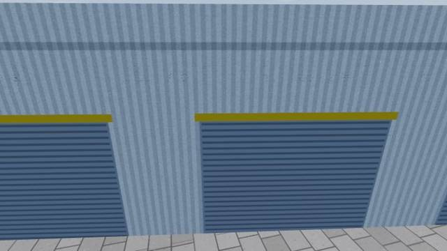 |
| 🆕 | -3254 | -271 | Carretera General del Norte (#4834) | zona nueva | en coche | El coche se queda atascado | 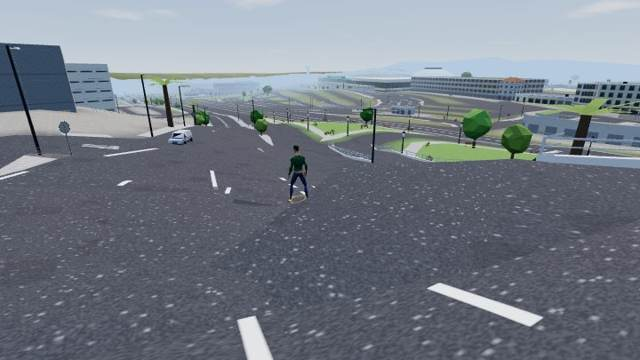 |
| 🆕 | -3087 | 48 | service (#4935) | zona nueva | en coche | El coche se queda atascado contra un obstáculo/muro | 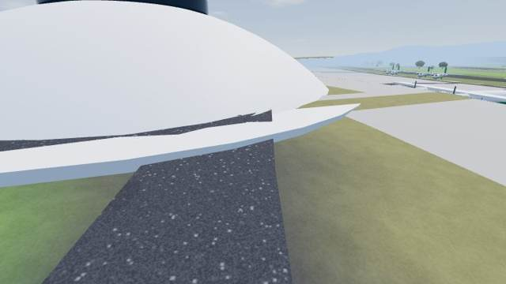 |
| 🆕 | -3083 | 26 | service (#4936) | zona nueva | en coche | El coche se queda atascado contra un obstáculo/muro | 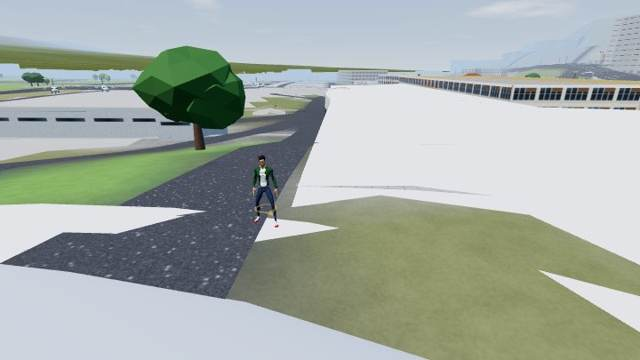 |
| 🆕 | -3032 | 49 | service (#4937) | zona nueva | en coche | El coche se queda atascado contra un obstáculo/muro | 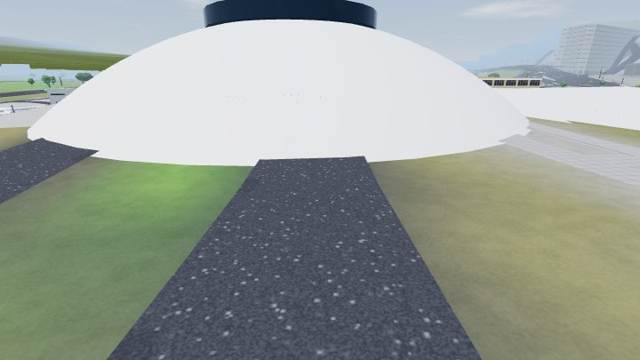 |
| 🆕 | -86 | 232 | Calle Heraclio Sánchez (#0) | zona nueva | a pie | El personaje se queda atascado andando por el camino | 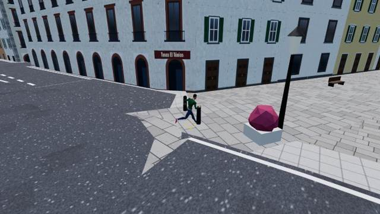 |
| 🆕 | -279 | 583 | footway (#3879) | zona nueva | a pie | El personaje se queda atascado andando por el camino | 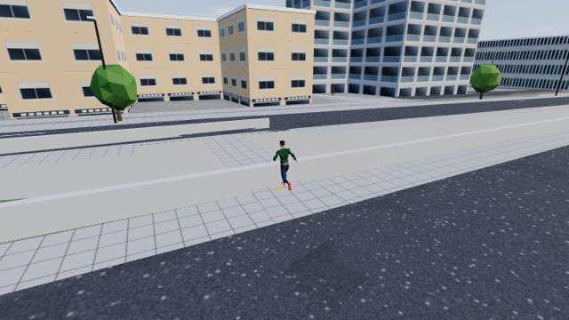 |
| 🆕 | -3065 | 17 | footway (#5106) | zona nueva | a pie | El personaje se queda atascado andando por el camino | 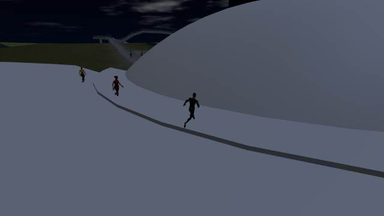 |
| 🆕 | -2987 | 61 | footway (#5107) | zona nueva | a pie | El personaje se queda atascado andando por el camino | 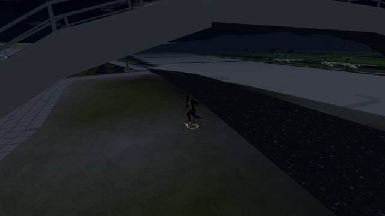 |
| 🆕 | -3146 | 84 | footway (#5172) | zona nueva | a pie | El personaje se queda atascado andando por el camino | 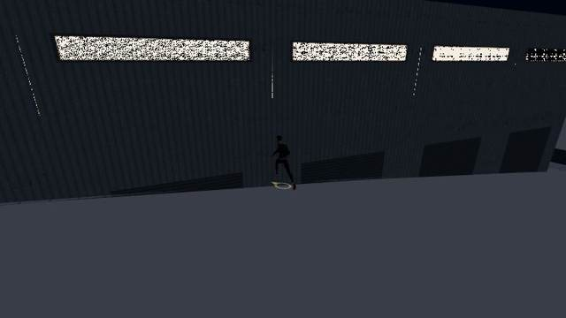 |
| 🆕 | -3150 | 101 | footway (#5174) | zona nueva | a pie | El personaje se queda atascado andando por el camino | 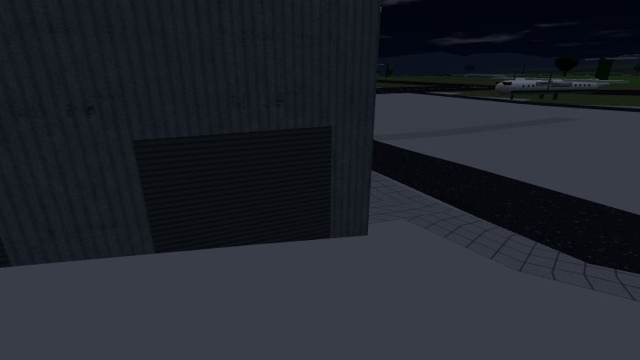 |
| 🆕 | -3162 | -3 | footway (#5179) | zona nueva | a pie | El personaje se queda atascado andando por el camino | 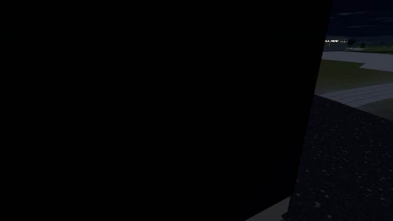 |
| ↻ | 820 | 3494 | Travesía Enlace Andenes Sobradillo (#1232) | riesgo | en coche | El coche se queda atascado | 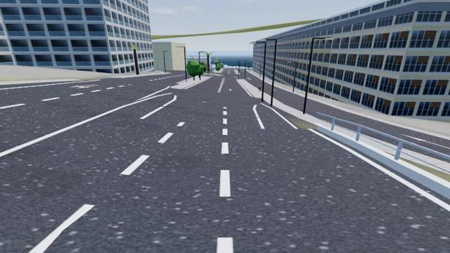 |
| ↻ | 377 | -268 | Vía de Ronda de La Laguna (#2576) | riesgo | en coche | El coche se queda atascado | 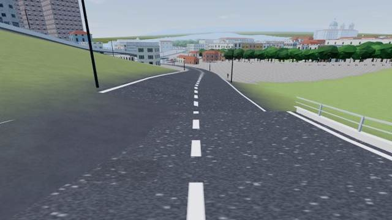 |

## Objetos flotando sobre la calzada (13)

| | X | Z | Vía | Pasada | Prueba | Detalle | Captura |
|---|---|---|---|---|---|---|---|
| 🆕 | 342 | 477 | unclassified (#1922) | rotación | superficies | Algo plano («footway») flota 0.8 m sobre la calzada | 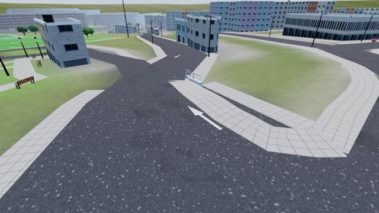 |
| 🆕 | -3278 | -271 | secondary_link (#4717) | zona nueva | superficies | Algo plano («asphaltLines») flota 0.8 m sobre la calzada | 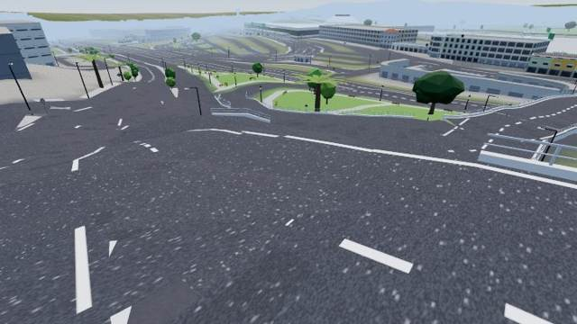 |
| 🆕 | -2273 | -300 | service (#4746) | zona nueva | superficies | Algo plano («asphalt») flota 1.3 m sobre la calzada | 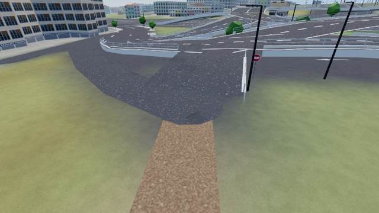 |
| 🆕 | -3268 | -269 | secondary_link (#4835) | zona nueva | superficies | Algo plano («asphaltLines») flota 1.3 m sobre la calzada |  |
| 🆕 | -3078 | 37 | service (#4934) | zona nueva | superficies | Algo plano (aeropuerto2 #f2f2ef) flota 3.1 m sobre la calzada | 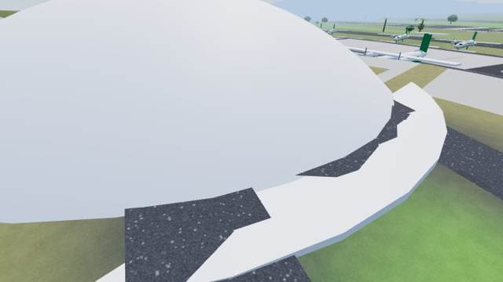 |
| 🆕 | -3080 | 49 | service (#4935) | zona nueva | superficies | Algo plano (aeropuerto2 #f2f2ef) flota 1.9 m sobre la calzada |  |
| 🆕 | -3078 | 32 | service (#4936) | zona nueva | superficies | Algo plano (aeropuerto2 #f2f2ef) flota 1.3 m sobre la calzada | 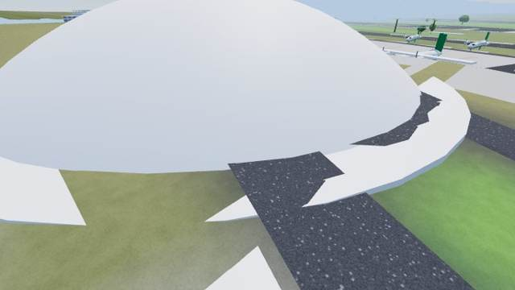 |
| 🆕 | -3039 | 47 | service (#4937) | zona nueva | superficies | Algo plano (aeropuerto2 #f2f2ef) flota 2.3 m sobre la calzada | 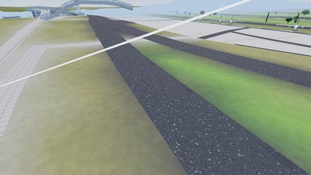 |
| 🆕 | -3049 | 60 | service (#4938) | zona nueva | superficies | Algo plano (aeropuerto2 #f2f2ef) flota 2.9 m sobre la calzada | 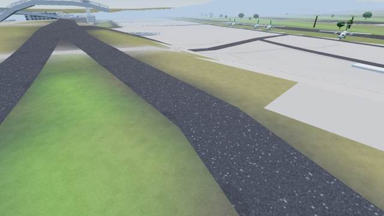 |
| 🆕 | -3250 | -376 | service (#5068) | zona nueva | superficies | Algo plano (objeto #ffffff) flota 0.6 m sobre la calzada |  |
| ↻ | 519 | -337 | Camino Las Estaciones (#637) | riesgo | superficies | Algo plano («asphalt») flota 0.8 m sobre la calzada | 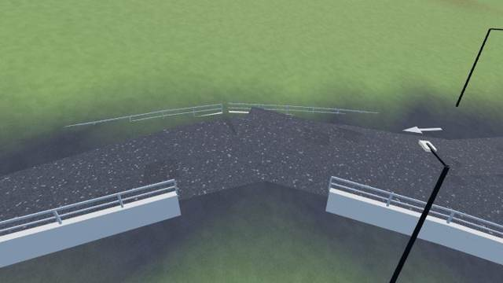 |
| ↻ | 2097 | 3544 | Calle San Camilo (#1674) | riesgo | superficies | Algo plano («asphalt») flota 0.7 m sobre la calzada | 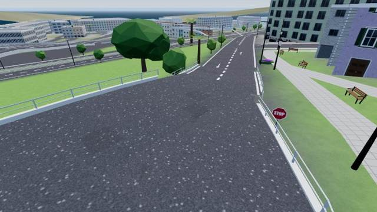 |
| ↻ | -3255 | -251 | motorway_link (#4884) | zona nueva | superficies | Algo plano («asphalt») flota 0.9 m sobre la calzada | 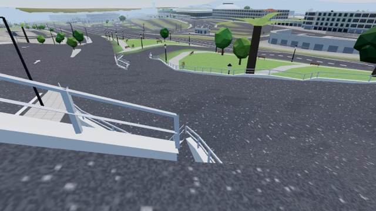 |

## Se hunde (11)

| | X | Z | Vía | Pasada | Prueba | Detalle | Captura |
|---|---|---|---|---|---|---|---|
| 🆕 | 962 | 2710 | footway (#1638) | rotación | a pie | El personaje se hunde 0.96 m bajo la superficie visible (suelo) | 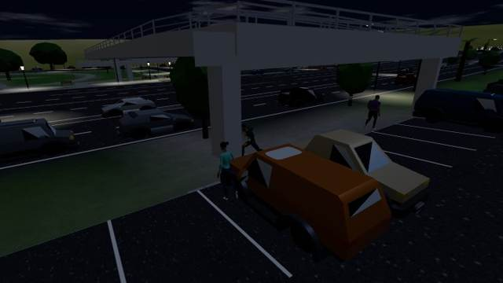 |
| 🆕 | 618 | -777 | path (#1786) | rotación | a pie | El personaje se hunde 0.87 m bajo la superficie visible (suelo) | 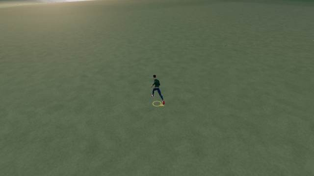 |
| 🆕 | 2248 | 3253 | footway (#1946) | rotación | a pie | El personaje se hunde 0.74 m bajo la superficie visible (trim) | 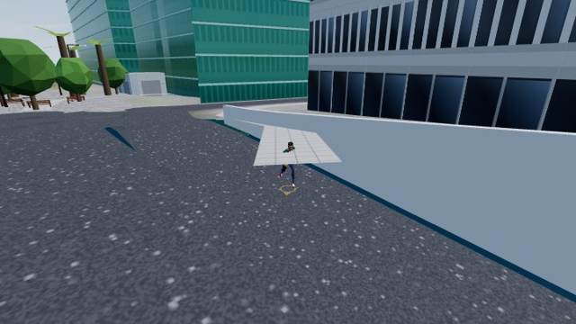 |
| 🆕 | -261 | 584 | footway (#4231) | zona nueva | a pie | El personaje se hunde 1.04 m bajo la superficie visible (suelo) | 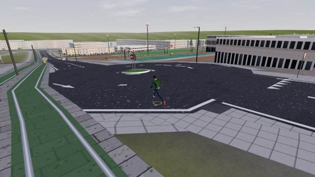 |
| 🆕 | -2939 | 90 | footway (#5103) | zona nueva | a pie | El personaje se hunde 0.60 m bajo la superficie visible (footway) | 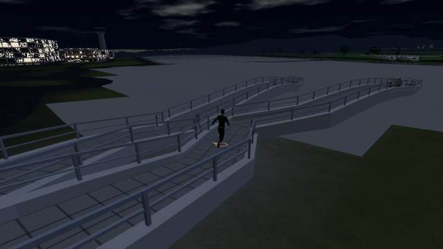 |
| 🆕 | -3042 | 28 | footway (#5106) | zona nueva | a pie | El personaje se hunde 0.38 m bajo la superficie visible (suelo) |  |
| 🆕 | -3040 | 31 | footway (#5112) | zona nueva | a pie | El personaje se hunde 0.69 m bajo la superficie visible (suelo) | 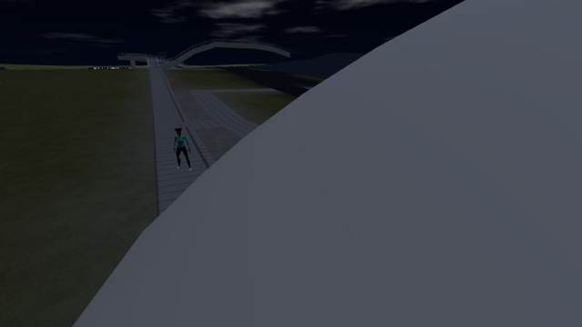 |
| 🆕 | -3087 | 16 | footway (#5116) | zona nueva | a pie | El personaje se hunde 0.85 m bajo la superficie visible (suelo) | 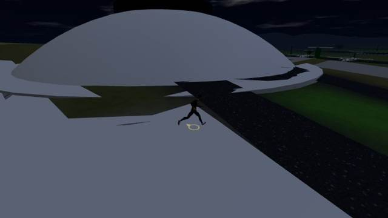 |
| 🆕 | -3065 | 17 | footway (#5120) | zona nueva | a pie | El personaje se hunde 0.27 m bajo la superficie visible (suelo) | 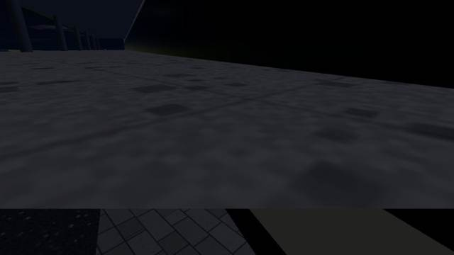 |
| 🆕 | -2983 | 104 | footway (#5181) | zona nueva | a pie | El personaje se hunde 0.27 m bajo la superficie visible (footway) | 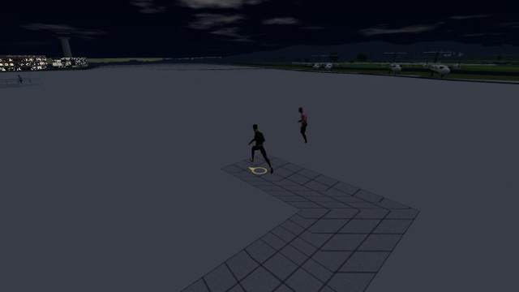 |
| ↻ | -166 | 729 | footway (#3893) | zona nueva | a pie | El personaje se hunde 0.53 m bajo la superficie visible (suelo) | 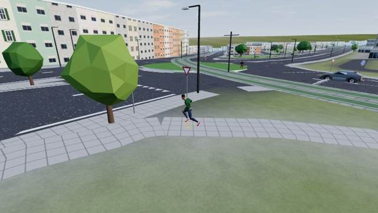 |

## Texturas cruzadas (suelo sobre la carretera) (8)

| | X | Z | Vía | Pasada | Prueba | Detalle | Captura |
|---|---|---|---|---|---|---|---|
| 🆕 | -3223 | -361 | Camino del Púlpito (#4733) | zona nueva | superficies | Superficie objeto #ffffff 0.10 m por encima del asfalto | 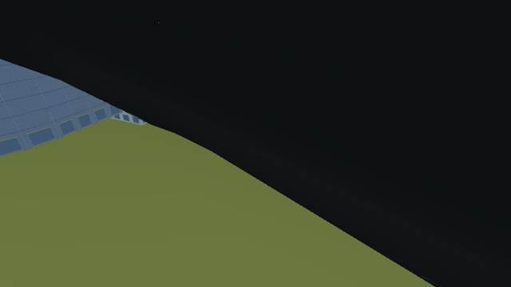 |
| 🆕 | -3085 | 47 | service (#4935) | zona nueva | superficies | Superficie aeropuerto2 #f2f2ef 0.29 m por encima del asfalto | 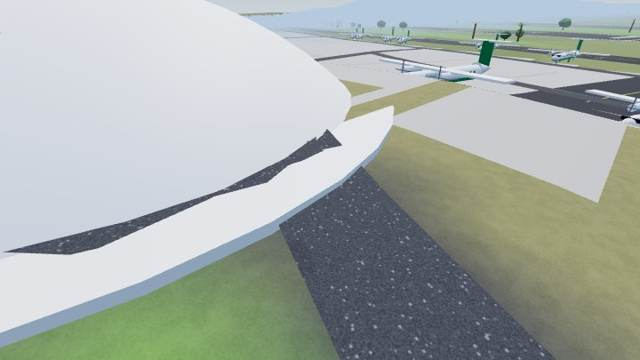 |
| 🆕 | -3164 | -376 | Camino Reja (#4995) | zona nueva | superficies | Superficie objeto #ffffff 0.18 m por encima del asfalto | 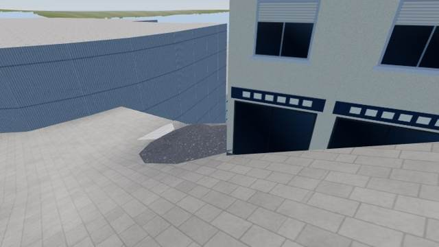 |
| 🆕 | -3288 | -312 | service (#5045) | zona nueva | superficies | Superficie objeto #ffffff 0.08 m por encima del asfalto | 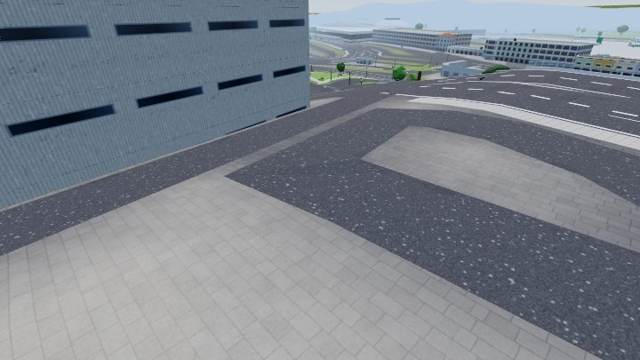 |
| 🆕 | -3256 | -402 | service (#5068) | zona nueva | superficies | Superficie objeto #ffffff 0.06 m por encima del asfalto | 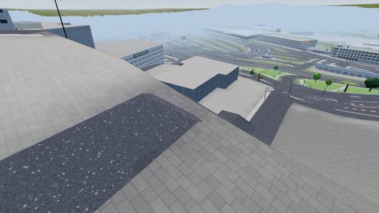 |
| ↻ | 2099 | 3549 | motorway_link (#719) | riesgo | superficies | Superficie «trim» 0.20 m por encima del asfalto | 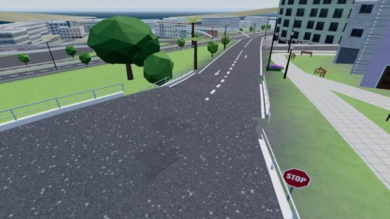 |
| ↻ | 2099 | 3549 | Calle San Camilo (#1674) | riesgo | superficies | Superficie «trim» 0.20 m por encima del asfalto |  |
| ↻ | -3296 | -281 | secondary_link (#4835) | zona nueva | superficies | Superficie objeto #ffffff 0.13 m por encima del asfalto | 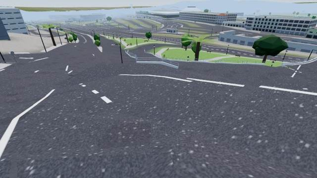 |

## Vuela sobre la calzada (7)

| | X | Z | Vía | Pasada | Prueba | Detalle | Captura |
|---|---|---|---|---|---|---|---|
| 🆕 | -2267 | -300 | service (#4746) | zona nueva | en coche | El coche va 1.0 m por encima de la calzada | 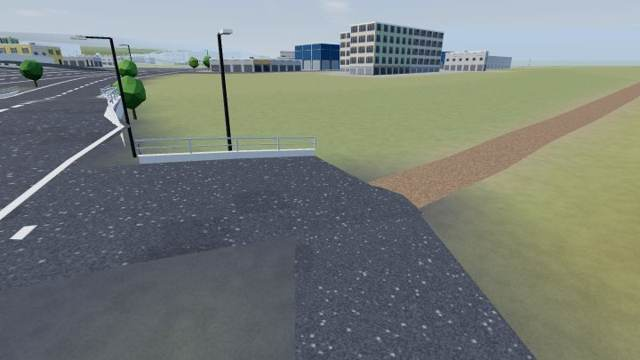 |
| 🆕 | -3254 | -272 | Carretera General del Norte (#4834) | zona nueva | en coche | El coche va 1.5 m por encima de la calzada |  |
| 🆕 | -3254 | -251 | motorway_link (#4884) | zona nueva | en coche | El coche va 1.0 m por encima de la calzada | 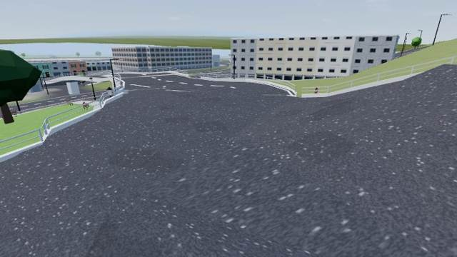 |
| 🆕 | -3247 | -359 | service (#5068) | zona nueva | en coche | El coche va 1.6 m por encima de la calzada | 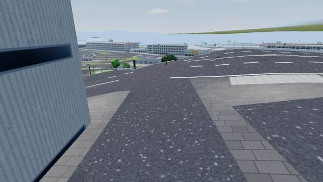 |
| ↻ | -495 | 683 | service (#2704) | riesgo | en coche | El coche va 1.3 m por encima de la calzada |  |
| ↻ | -3269 | -270 | secondary_link (#4835) | zona nueva | en coche | El coche va 1.4 m por encima de la calzada | 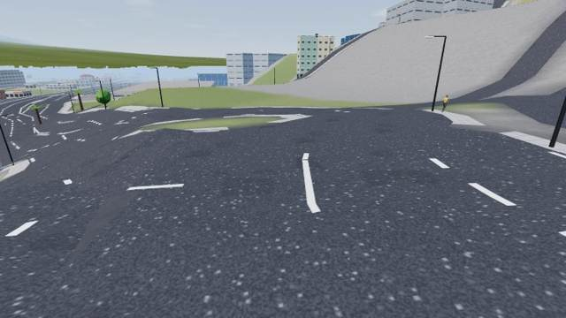 |
| ↻ | -3274 | -265 | secondary_link (#4866) | zona nueva | en coche | El coche va 1.3 m por encima de la calzada |  |

## Edificios sobre la vía (6)

| | X | Z | Vía | Pasada | Prueba | Detalle | Captura |
|---|---|---|---|---|---|---|---|
| 🆕 | -859 | 84 | service (#2011) | rotación | en coche | Un edificio tapa la vía: la calle entra en él (dato de OSM o edificio mal puesto) | 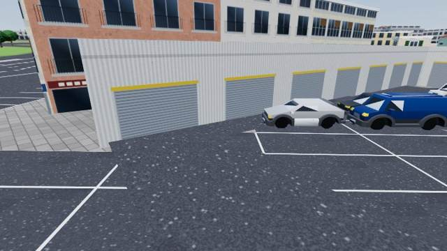 |
| 🆕 | 804 | 904 | footway (#1998) | rotación | a pie | Un edificio tapa el camino | 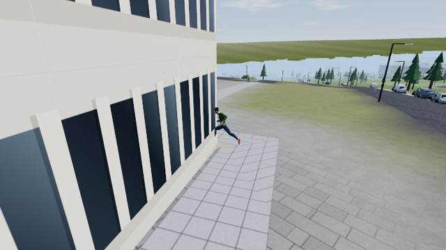 |
| 🆕 | 1018 | 1588 | Calle La Tierra (#2071) | rotación | a pie | Un edificio tapa el camino | 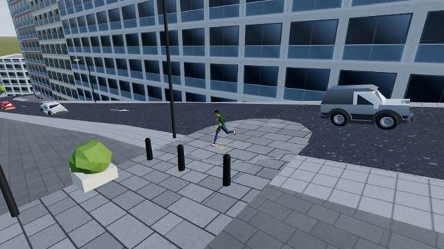 |
| 🆕 | -3072 | -67 | service (#5037) | zona nueva | en coche | Un edificio tapa la vía: la calle entra en él (dato de OSM o edificio mal puesto) | 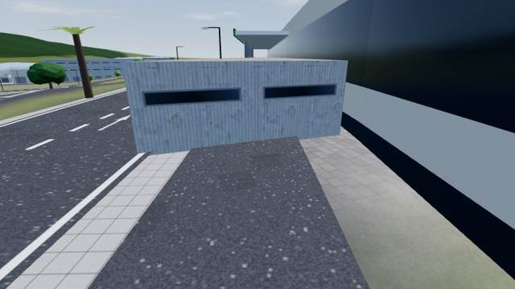 |
| 🆕 | -3126 | 36 | footway (#4952) | zona nueva | a pie | Un edificio tapa el camino | 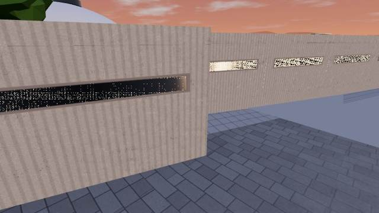 |
| ↻ | -176 | -66 | Pasaje Teide (#753) | zona nueva | a pie | Un edificio tapa el camino |  |

## Se sale de la calzada (5)

| | X | Z | Vía | Pasada | Prueba | Detalle | Captura |
|---|---|---|---|---|---|---|---|
| 🆕 | -3063 | 69 | service (#4938) | zona nueva | en coche | El coche se sale de la calzada (13.1 m del eje) |  |
| 🆕 | -2604 | 97 | service (#4980) | zona nueva | en coche | El coche se sale de la calzada (5.8 m del eje) |  |
| 🆕 | -2568 | 2 | service (#4982) | zona nueva | en coche | El coche se sale de la calzada (5.6 m del eje) |  |
| 🆕 | -2982 | -241 | service (#4998) | zona nueva | en coche | El coche se sale de la calzada (5.8 m del eje) |  |
| ↻ | 315 | 290 | Calle Ladera de San Roque (#845) | riesgo | en coche | El coche se sale de la calzada (5.7 m del eje) |  |

## Saltos de altura (3)

| | X | Z | Vía | Pasada | Prueba | Detalle | Captura |
|---|---|---|---|---|---|---|---|
| 🆕 | -3247 | -359 | service (#5068) | zona nueva | en coche | Salto brusco de altura (1.7 m en un fotograma) |  |
| ↻ | -495 | 683 | service (#2704) | riesgo | en coche | Salto brusco de altura (-1.2 m en un fotograma) |  |
| ↻ | -3274 | -264 | secondary_link (#4866) | zona nueva | en coche | Salto brusco de altura (-1.4 m en un fotograma) |  |

## No termina el recorrido (1)

| | X | Z | Vía | Pasada | Prueba | Detalle | Captura |
|---|---|---|---|---|---|---|---|
| ↻ | 480 | -307 | Calle Pista Militar San Roque (#557) | riesgo | en coche | No termina la vía en 38 s (90 m sin recorrer) |  |
