# Revisión de jugabilidad — v0.78.0 (2026-10-19 1602)

Agente revisor automático. Estado: **terminado**. Tiempo: 198 s.

- Zonas nuevas de esta versión: TF-13 bajo la TF-5 (rotonda en trinchera), Tranvía bajo tierra Trinidad / Padre Anchieta, Casco: Obispado y calles del callejero, Aeropuerto (terminal, naves, San Lázaro).
- Plan: surf 953, walk 194, drive 953.
- Comparado con: revision_v0.73.0_2026-10-13_1229.json.

**38 avisos: 14 nuevos, 24 siguen; 36 arreglados desde el informe anterior.**

## Arreglados

| X | Z | Vía | Tipo |
|---|---|---|---|
| -3278 | -271 | secondary_link (#4717) | Objetos flotando sobre la calzada |
| -3223 | -361 | Camino del Púlpito (#4733) | Texturas cruzadas (suelo sobre la carretera) |
| -2273 | -300 | service (#4746) | Objetos flotando sobre la calzada |
| -3268 | -269 | secondary_link (#4835) | Objetos flotando sobre la calzada |
| -3296 | -281 | secondary_link (#4835) | Texturas cruzadas (suelo sobre la carretera) |
| -3255 | -251 | motorway_link (#4884) | Objetos flotando sobre la calzada |
| -3078 | 37 | service (#4934) | Objetos flotando sobre la calzada |
| -3085 | 47 | service (#4935) | Texturas cruzadas (suelo sobre la carretera) |
| -3080 | 49 | service (#4935) | Objetos flotando sobre la calzada |
| -3078 | 32 | service (#4936) | Objetos flotando sobre la calzada |
| -3039 | 47 | service (#4937) | Objetos flotando sobre la calzada |
| -3049 | 60 | service (#4938) | Objetos flotando sobre la calzada |
| -3164 | -376 | Camino Reja (#4995) | Texturas cruzadas (suelo sobre la carretera) |
| -3288 | -312 | service (#5045) | Texturas cruzadas (suelo sobre la carretera) |
| -3250 | -376 | service (#5068) | Objetos flotando sobre la calzada |
| -3256 | -402 | service (#5068) | Texturas cruzadas (suelo sobre la carretera) |
| 2099 | 3549 | motorway_link (#719) | Texturas cruzadas (suelo sobre la carretera) |
| 2097 | 3544 | Calle San Camilo (#1674) | Objetos flotando sobre la calzada |
| 2099 | 3549 | Calle San Camilo (#1674) | Texturas cruzadas (suelo sobre la carretera) |
| -2267 | -300 | service (#4746) | Vuela sobre la calzada |
| -3254 | -251 | motorway_link (#4884) | Vuela sobre la calzada |
| -3087 | 48 | service (#4935) | Atascos |
| -3083 | 26 | service (#4936) | Atascos |
| -3032 | 49 | service (#4937) | Atascos |
| -3063 | 69 | service (#4938) | Se sale de la calzada |
| 820 | 3494 | Travesía Enlace Andenes Sobradillo (#1232) | Atascos |
| 377 | -268 | Vía de Ronda de La Laguna (#2576) | Atascos |
| -495 | 683 | service (#2704) | Vuela sobre la calzada |
| -495 | 683 | service (#2704) | Saltos de altura |
| -176 | -66 | Pasaje Teide (#753) | Edificios sobre la vía |
| -166 | 729 | footway (#3893) | Se hunde |
| -261 | 584 | footway (#4231) | Se hunde |
| -2939 | 90 | footway (#5103) | Se hunde |
| -2987 | 61 | footway (#5107) | Atascos |
| -3040 | 31 | footway (#5112) | Se hunde |
| -2983 | 104 | footway (#5181) | Se hunde |

## Atascos (11)

| | X | Z | Vía | Pasada | Prueba | Detalle | Captura |
|---|---|---|---|---|---|---|---|
| 🆕 | 2210 | 3588 | motorway_link (#2346) | riesgo | en coche | El coche se queda atascado |  |
| 🆕 | 674 | 3460 | path (#2562) | rotación | a pie | El personaje se queda atascado andando por el camino | 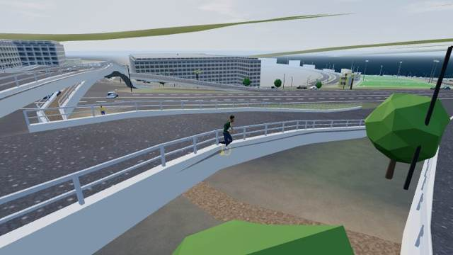 |
| 🆕 | -759 | 512 | footway (#2687) | rotación | a pie | El personaje se queda atascado andando por el camino | 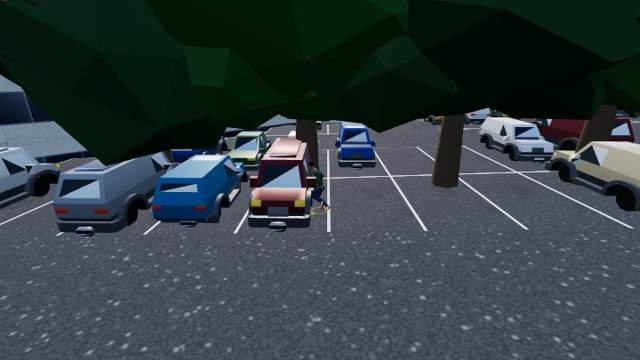 |
| 🆕 | -3052 | 39 | footway (#5112) | zona nueva | a pie | El personaje se queda atascado andando por el camino | 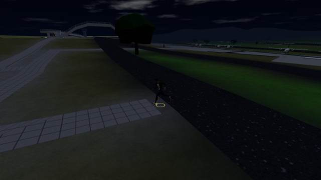 |
| ↻ | -3254 | -271 | Carretera General del Norte (#4834) | zona nueva | en coche | El coche se queda atascado |  |
| ↻ | -86 | 232 | Calle Heraclio Sánchez (#0) | zona nueva | a pie | El personaje se queda atascado andando por el camino | 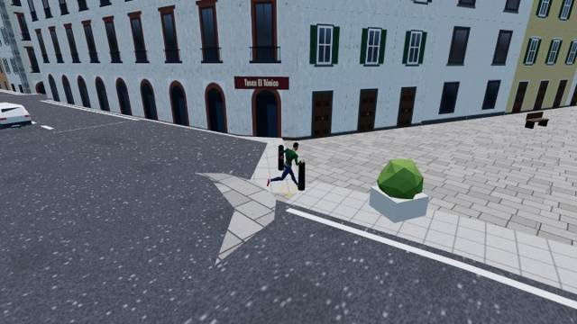 |
| ↻ | -279 | 583 | footway (#3879) | zona nueva | a pie | El personaje se queda atascado andando por el camino | 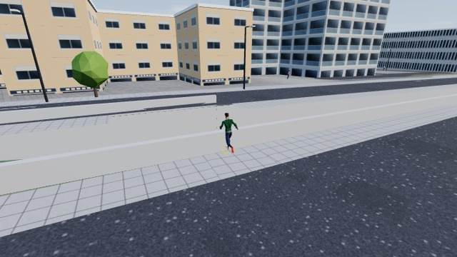 |
| ↻ | -3066 | 21 | footway (#5106) | zona nueva | a pie | El personaje se queda atascado andando por el camino |  |
| ↻ | -3146 | 84 | footway (#5172) | zona nueva | a pie | El personaje se queda atascado andando por el camino | 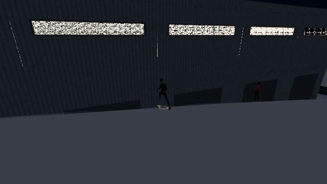 |
| ↻ | -3150 | 101 | footway (#5174) | zona nueva | a pie | El personaje se queda atascado andando por el camino | 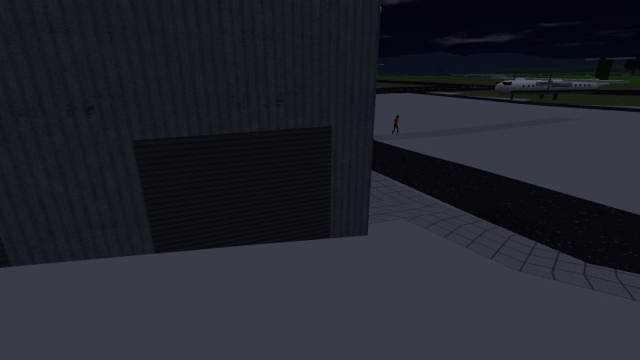 |
| ↻ | -3162 | -3 | footway (#5179) | zona nueva | a pie | El personaje se queda atascado andando por el camino |  |

## Vuela sobre la calzada (7)

| | X | Z | Vía | Pasada | Prueba | Detalle | Captura |
|---|---|---|---|---|---|---|---|
| 🆕 | 516 | -332 | Camino Las Estaciones (#637) | riesgo | en coche | El coche va 1.0 m por encima de la calzada | 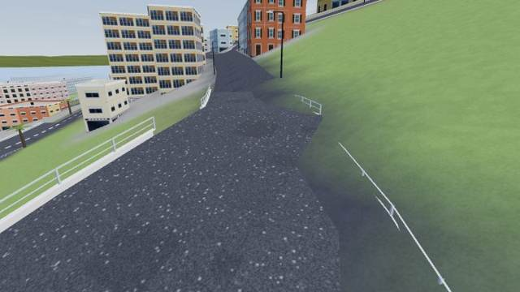 |
| 🆕 | 946 | 2849 | service (#1226) | riesgo | en coche | El coche va 2.5 m por encima de la calzada | 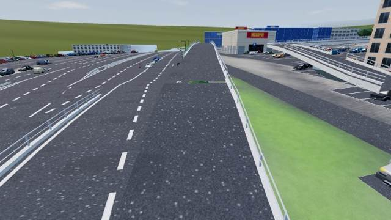 |
| 🆕 | 2210 | 3587 | motorway_link (#2346) | riesgo | en coche | El coche va 1.6 m por encima de la calzada | 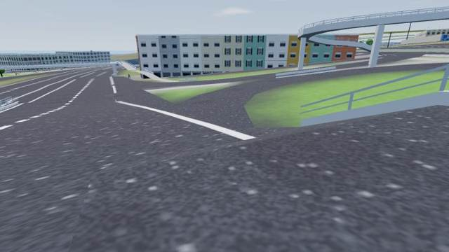 |
| ↻ | -3254 | -271 | Carretera General del Norte (#4834) | zona nueva | en coche | El coche va 1.0 m por encima de la calzada | 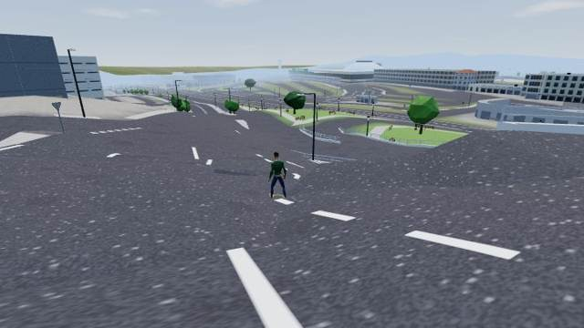 |
| ↻ | -3269 | -270 | secondary_link (#4835) | zona nueva | en coche | El coche va 1.3 m por encima de la calzada | 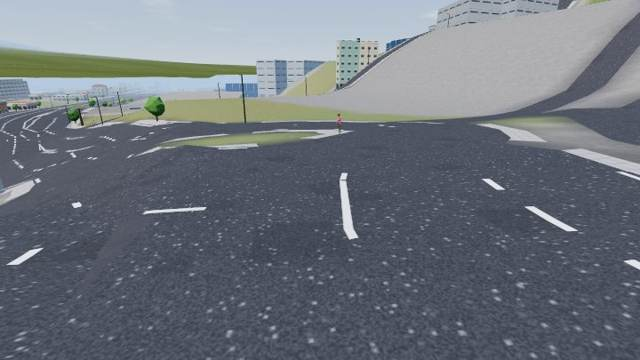 |
| ↻ | -3274 | -265 | secondary_link (#4866) | zona nueva | en coche | El coche va 1.3 m por encima de la calzada |  |
| ↻ | -3247 | -359 | service (#5068) | zona nueva | en coche | El coche va 1.5 m por encima de la calzada | 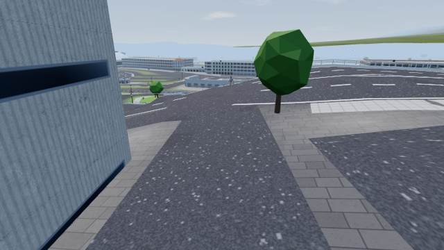 |

## Se sale de la calzada (5)

| | X | Z | Vía | Pasada | Prueba | Detalle | Captura |
|---|---|---|---|---|---|---|---|
| 🆕 | 363 | -1250 | Camino Madre del Agua (#2226) | rotación | en coche | El coche se sale de la calzada (5.6 m del eje) | 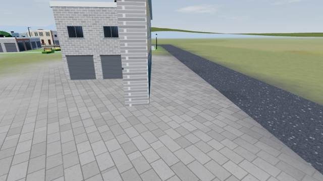 |
| ↻ | 315 | 289 | Calle Ladera de San Roque (#845) | riesgo | en coche | El coche se sale de la calzada (5.6 m del eje) | 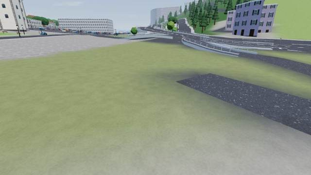 |
| ↻ | -2604 | 97 | service (#4980) | zona nueva | en coche | El coche se sale de la calzada (5.8 m del eje) | 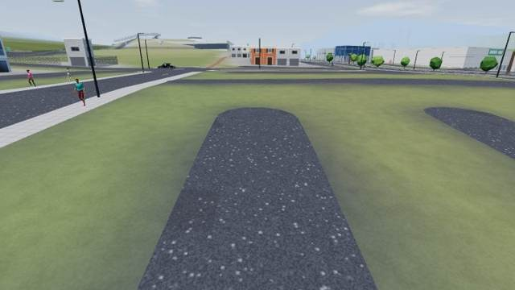 |
| ↻ | -2570 | 2 | service (#4982) | zona nueva | en coche | El coche se sale de la calzada (5.7 m del eje) | 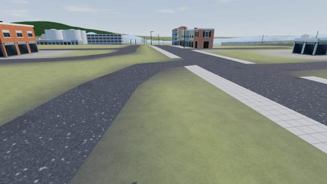 |
| ↻ | -2982 | -241 | service (#4998) | zona nueva | en coche | El coche se sale de la calzada (6.0 m del eje) | 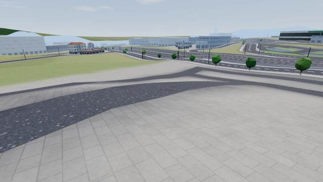 |

## Se hunde (5)

| | X | Z | Vía | Pasada | Prueba | Detalle | Captura |
|---|---|---|---|---|---|---|---|
| 🆕 | 720 | 3389 | motorway_link (#826) | riesgo | en coche | El coche va 1.9 m por debajo de la calzada |  |
| 🆕 | -174 | -137 | Plaza de los Remedios (#782) | zona nueva | a pie | El personaje se hunde 0.46 m bajo la superficie visible (wood) | 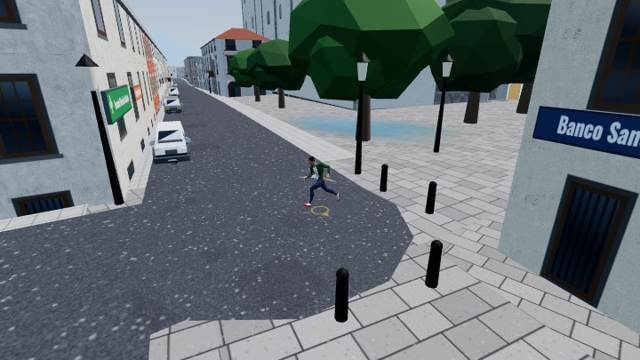 |
| ↻ | -3040 | 29 | footway (#5106) | zona nueva | a pie | El personaje se hunde 0.27 m bajo la superficie visible (suelo) | 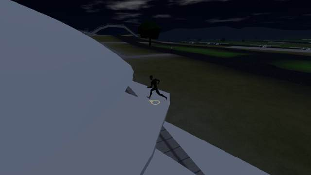 |
| ↻ | -3087 | 16 | footway (#5116) | zona nueva | a pie | El personaje se hunde 0.83 m bajo la superficie visible (suelo) | 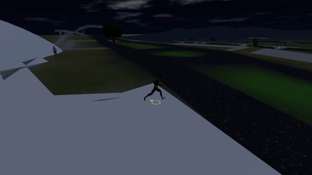 |
| ↻ | -3068 | 17 | footway (#5120) | zona nueva | a pie | El personaje se hunde 0.26 m bajo la superficie visible (suelo) | 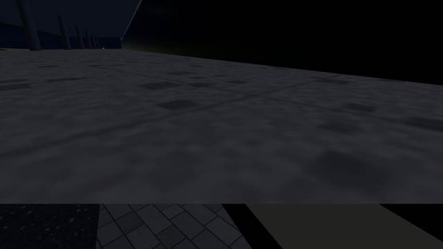 |

## Saltos de altura (4)

| | X | Z | Vía | Pasada | Prueba | Detalle | Captura |
|---|---|---|---|---|---|---|---|
| 🆕 | 720 | 3389 | motorway_link (#826) | riesgo | en coche | Salto brusco de altura (-1.8 m en un fotograma) | 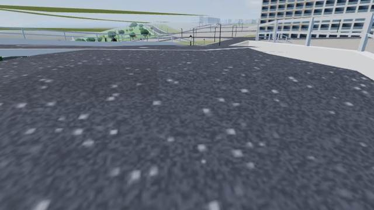 |
| 🆕 | 2210 | 3587 | motorway_link (#2346) | riesgo | en coche | Salto brusco de altura (1.4 m en un fotograma) |  |
| ↻ | -3274 | -264 | secondary_link (#4866) | zona nueva | en coche | Salto brusco de altura (-1.4 m en un fotograma) | 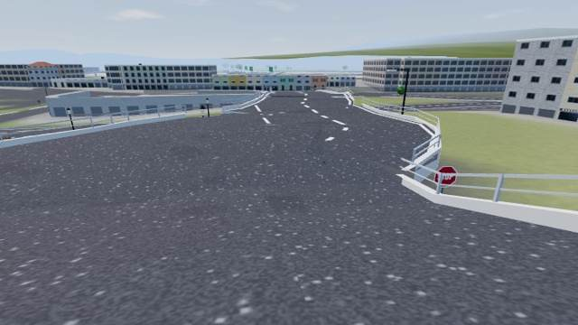 |
| ↻ | -3247 | -359 | service (#5068) | zona nueva | en coche | Salto brusco de altura (1.7 m en un fotograma) |  |

## Edificios sobre la vía (4)

| | X | Z | Vía | Pasada | Prueba | Detalle | Captura |
|---|---|---|---|---|---|---|---|
| 🆕 | 543 | -909 | Camino La Rúa (#308) | riesgo | en coche | Un edificio tapa la vía: la calle entra en él (dato de OSM o edificio mal puesto) | 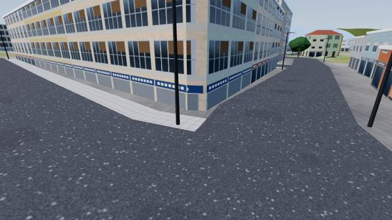 |
| 🆕 | -853 | 58 | service (#2569) | rotación | en coche | Un edificio tapa la vía: la calle entra en él (dato de OSM o edificio mal puesto) | 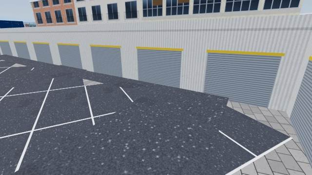 |
| ↻ | -3072 | -67 | service (#5037) | zona nueva | en coche | Un edificio tapa la vía: la calle entra en él (dato de OSM o edificio mal puesto) | 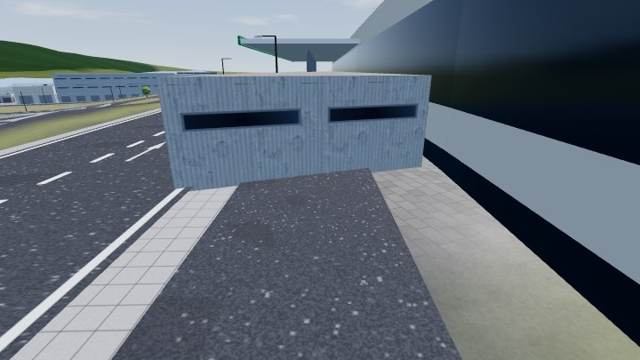 |
| ↻ | -3126 | 36 | footway (#4952) | zona nueva | a pie | Un edificio tapa el camino | 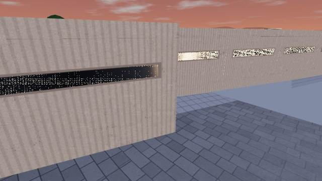 |

## Objetos flotando sobre la calzada (1)

| | X | Z | Vía | Pasada | Prueba | Detalle | Captura |
|---|---|---|---|---|---|---|---|
| ↻ | 516 | -332 | Camino Las Estaciones (#637) | riesgo | superficies | Algo plano («asphalt») flota 1.0 m sobre la calzada | 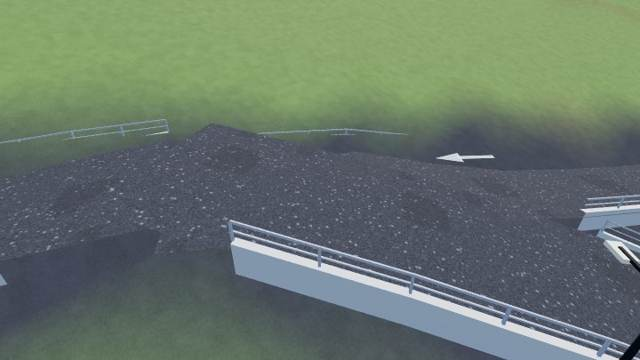 |

## No termina el recorrido (1)

| | X | Z | Vía | Pasada | Prueba | Detalle | Captura |
|---|---|---|---|---|---|---|---|
| ↻ | 481 | -307 | Calle Pista Militar San Roque (#557) | riesgo | en coche | No termina la vía en 38 s (90 m sin recorrer) | 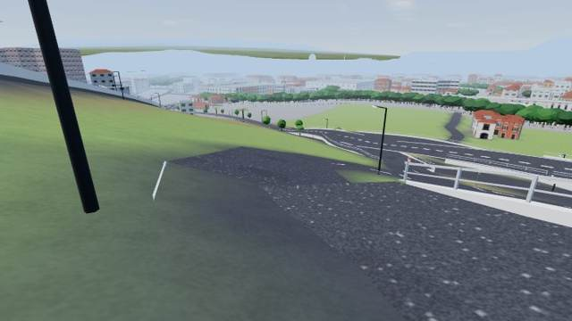 |
