# Revisión de jugabilidad — v0.99.6 (2026-11-02 1913)

Agente revisor automático. Estado: **terminado**. Tiempo: 1586 s.

- Zonas nuevas de esta versión: TF-13 bajo la TF-5 (rotonda en trinchera), Tranvía bajo tierra Trinidad / Padre Anchieta, Casco: Obispado y calles del callejero, Aeropuerto (terminal, naves, San Lázaro).
- Plan: surf 3722, walk 1684, drive 3722.
- Comparado con: revision_v0.78.0_2026-10-19_1602.json.

**144 avisos: 113 nuevos, 31 siguen; 7 arreglados desde el informe anterior.**

## Arreglados

| X | Z | Vía | Tipo |
|---|---|---|---|
| -3274 | -264 | secondary_link (#4866) | Saltos de altura |
| 946 | 2849 | service (#1226) | Vuela sobre la calzada |
| 2210 | 3587 | motorway_link (#2346) | Vuela sobre la calzada |
| 2210 | 3587 | motorway_link (#2346) | Saltos de altura |
| 2210 | 3588 | motorway_link (#2346) | Atascos |
| -174 | -137 | Plaza de los Remedios (#782) | Se hunde |
| -759 | 512 | footway (#2687) | Atascos |

## Atascos (47)

| | X | Z | Vía | Pasada | Prueba | Detalle | Captura |
|---|---|---|---|---|---|---|---|
| 🆕 | 2235 | 3470 | service (#352) | mapa entero | en coche | El coche se queda atascado contra un obstáculo/muro | 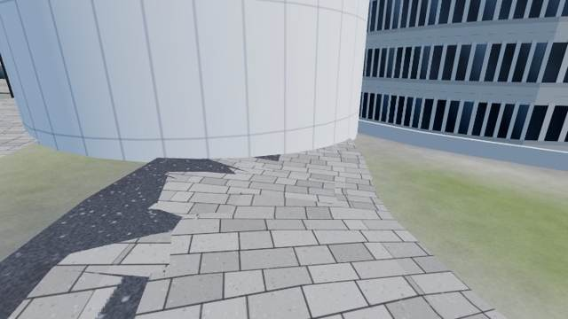 |
| 🆕 | -323 | 783 | secondary (#1187) | mapa entero | en coche | El coche se queda atascado | 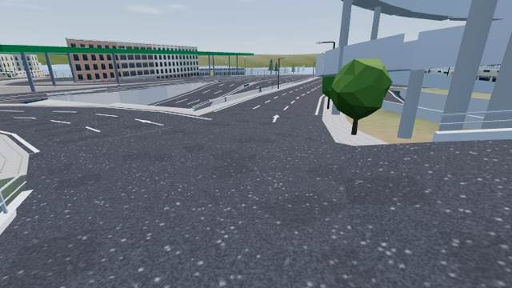 |
| 🆕 | -858 | 70 | service (#2008) | mapa entero | en coche | El coche se queda atascado | 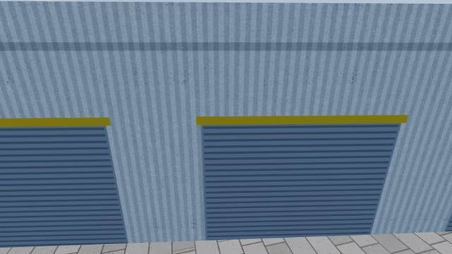 |
| 🆕 | 1769 | 3117 | tertiary (#2260) | mapa entero | en coche | El coche se queda atascado | 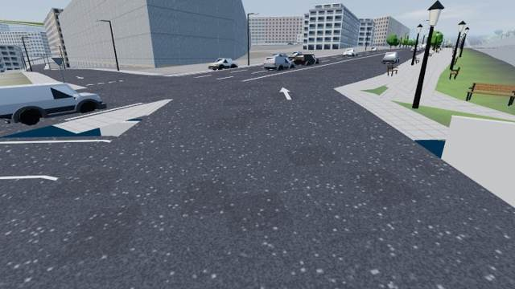 |
| 🆕 | 1896 | 3230 | Autopista del Norte (#2461) | mapa entero | en coche | El coche se queda atascado | 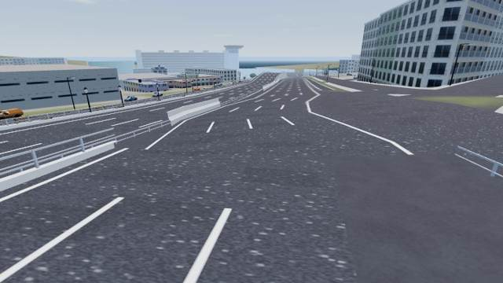 |
| 🆕 | 1857 | 3201 | motorway_link (#2467) | mapa entero | en coche | El coche se queda atascado |  |
| 🆕 | 1857 | 3201 | service (#2966) | mapa entero | en coche | El coche se queda atascado |  |
| 🆕 | 2211 | 3310 | service (#3098) | mapa entero | en coche | El coche se queda atascado |  |
| 🆕 | -948 | 1484 | Calle La Papa (#3117) | mapa entero | en coche | El coche se queda atascado contra un obstáculo/muro | 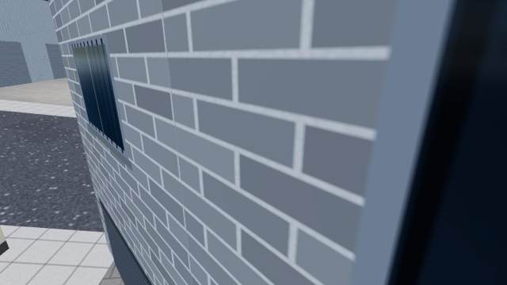 |
| 🆕 | 5 | 2330 | service (#3539) | mapa entero | en coche | El coche se queda atascado | 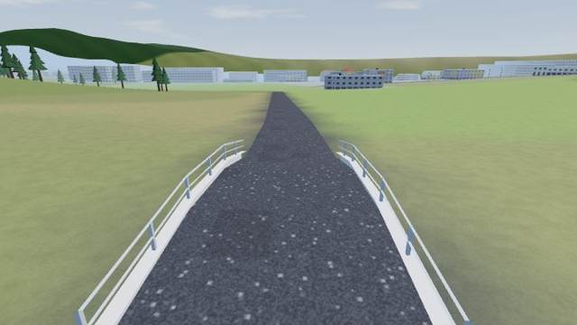 |
| 🆕 | 2199 | 3631 | footway (#932) | mapa entero | a pie | El personaje se queda atascado andando por el camino | 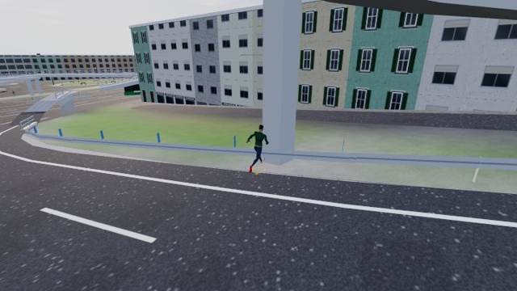 |
| 🆕 | -329 | 790 | footway (#1776) | mapa entero | a pie | El personaje se queda atascado andando por el camino | 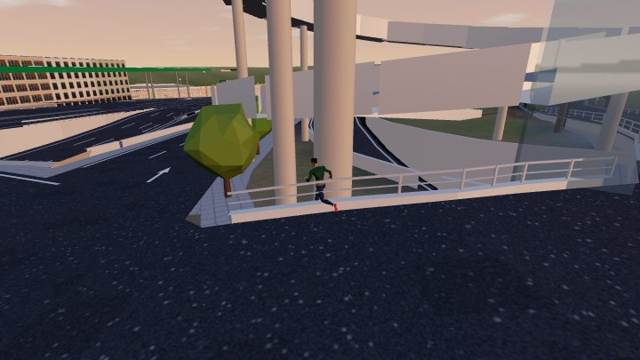 |
| 🆕 | 2348 | 1162 | path (#1836) | mapa entero | a pie | El personaje se queda atascado andando por el camino | 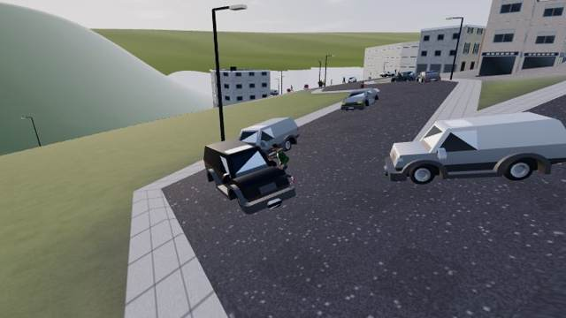 |
| 🆕 | 2214 | 3617 | footway (#1926) | mapa entero | a pie | El personaje se queda atascado andando por el camino | 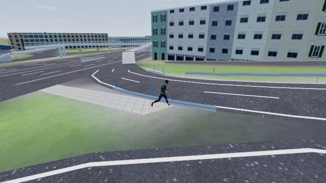 |
| 🆕 | 712 | 577 | footway (#2283) | mapa entero | a pie | El personaje se queda atascado andando por el camino | 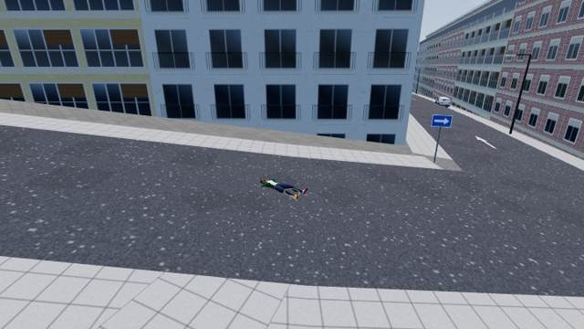 |
| 🆕 | 716 | 3469 | path (#2561) | mapa entero | a pie | El personaje se queda atascado andando por el camino | 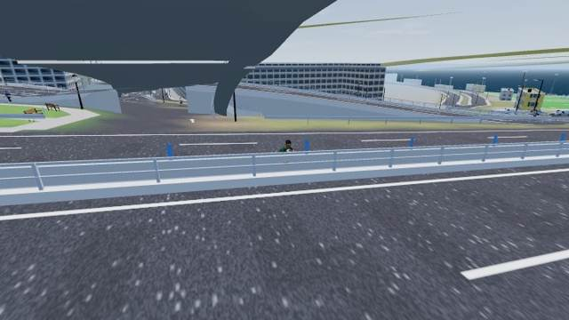 |
| 🆕 | 2183 | 3629 | footway (#3102) | mapa entero | a pie | El personaje se queda atascado andando por el camino | 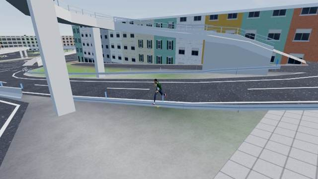 |
| 🆕 | 1044 | 2425 | footway (#3387) | mapa entero | a pie | El personaje se queda atascado andando por el camino | 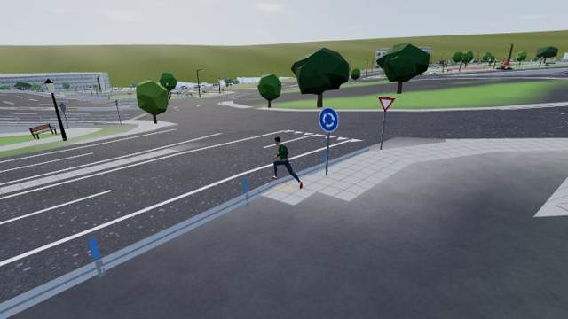 |
| 🆕 | 819 | 2911 | steps (#3991) | mapa entero | a pie | El personaje se queda atascado andando por el camino | 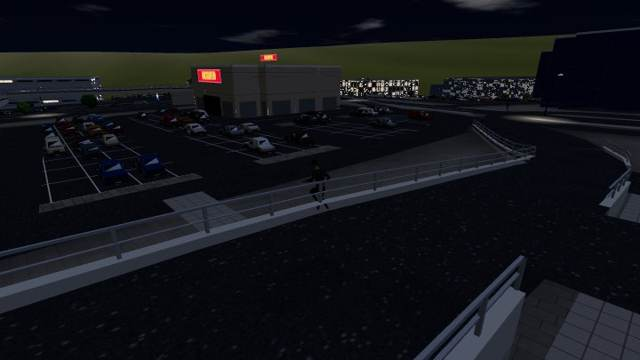 |
| 🆕 | 812 | 2913 | footway (#3992) | mapa entero | a pie | El personaje se queda atascado andando por el camino | 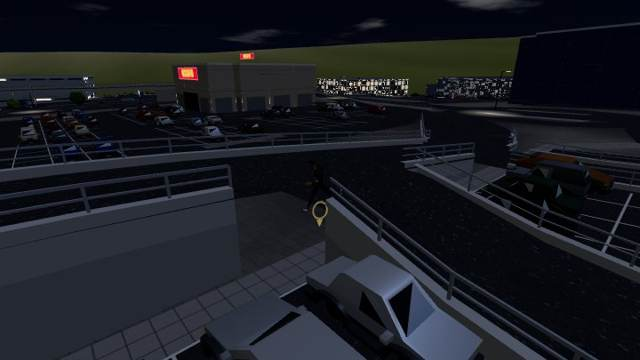 |
| 🆕 | 1155 | 2268 | footway (#4041) | mapa entero | a pie | El personaje se queda atascado andando por el camino | 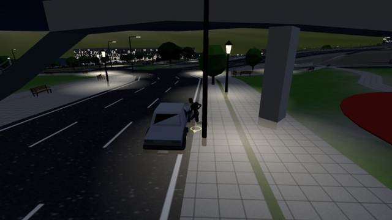 |
| 🆕 | 1171 | 2319 | footway (#4047) | mapa entero | a pie | El personaje se queda atascado andando por el camino | 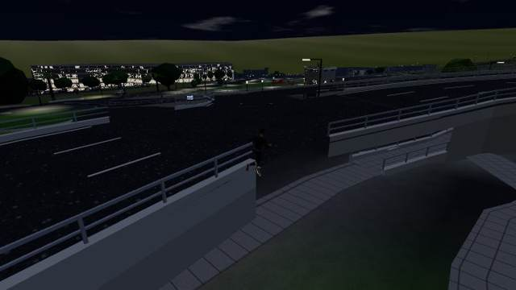 |
| 🆕 | 1097 | 2431 | footway (#4050) | mapa entero | a pie | El personaje se queda atascado andando por el camino | 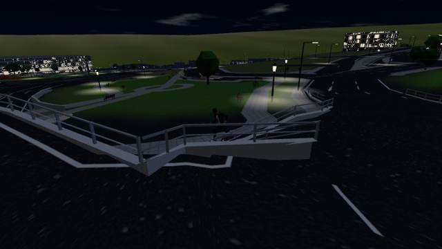 |
| 🆕 | 1133 | 2395 | footway (#4051) | mapa entero | a pie | El personaje se queda atascado andando por el camino | 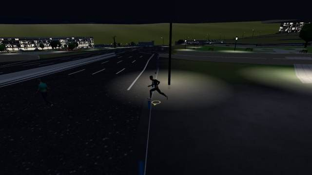 |
| 🆕 | 1196 | 2347 | footway (#4052) | mapa entero | a pie | El personaje se queda atascado andando por el camino | 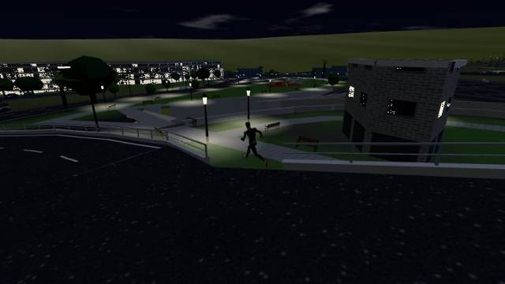 |
| 🆕 | 746 | 865 | footway (#4153) | mapa entero | a pie | El personaje se queda atascado andando por el camino | 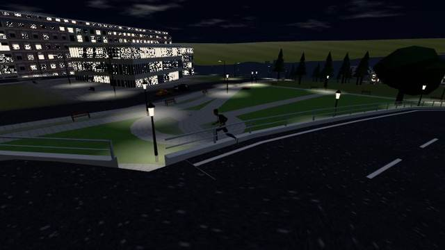 |
| 🆕 | -919 | 117 | footway (#4616) | mapa entero | a pie | El personaje se queda atascado andando por el camino | 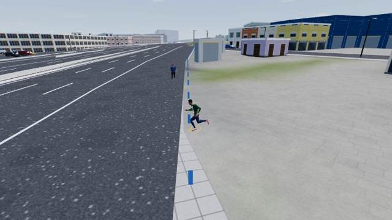 |
| 🆕 | -929 | 107 | footway (#4618) | mapa entero | a pie | El personaje se queda atascado andando por el camino | 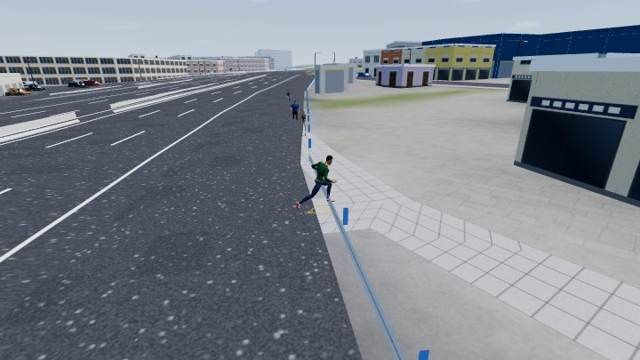 |
| 🆕 | -316 | 818 | path (#4678) | mapa entero | a pie | El personaje se queda atascado andando por el camino | 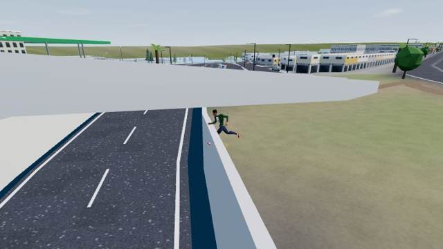 |
| 🆕 | -307 | 809 | path (#4680) | mapa entero | a pie | El personaje se queda atascado andando por el camino | 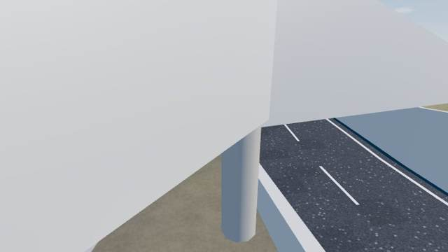 |
| 🆕 | -3759 | -272 | footway (#4819) | mapa entero | a pie | El personaje se queda atascado andando por el camino | 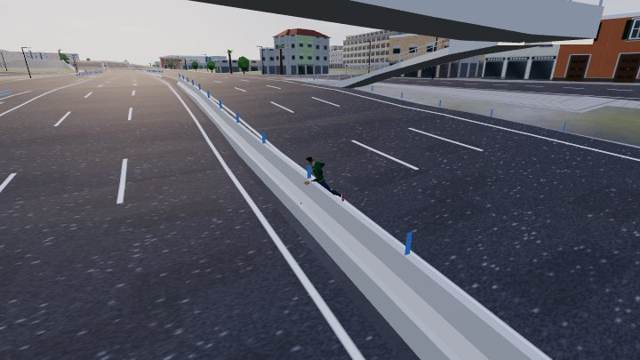 |
| 🆕 | -3726 | -247 | footway (#4820) | mapa entero | a pie | El personaje se queda atascado andando por el camino | 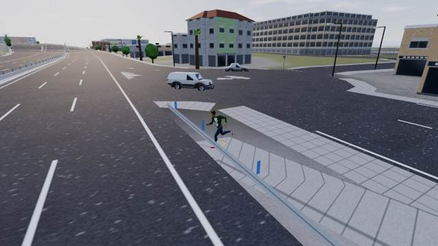 |
| 🆕 | 2632 | 2149 | footway (#5451) | mapa entero | a pie | El personaje se queda atascado andando por el camino | 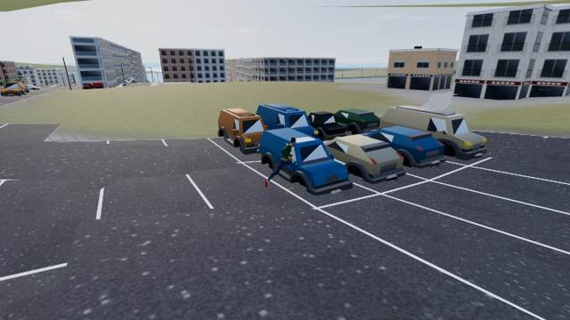 |
| 🆕 | 1799 | 4112 | path (#5567) | mapa entero | a pie | El personaje se queda atascado andando por el camino | 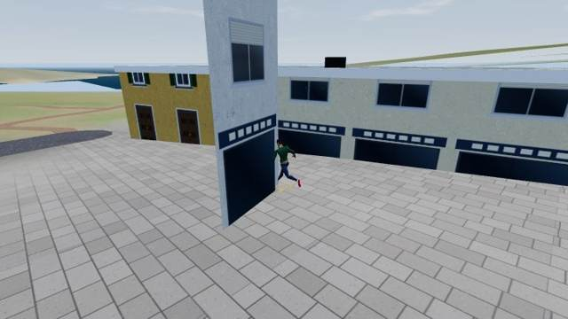 |
| 🆕 | -149 | -233 | Calle Juan de Vera (#211) | zona nueva | en coche | El coche se queda atascado contra un obstáculo/muro | 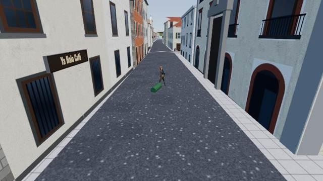 |
| 🆕 | -2951 | -93 | service (#4774) | zona nueva | en coche | El coche se queda atascado |  |
| 🆕 | -3276 | -267 | secondary_link (#4866) | zona nueva | en coche | El coche se queda atascado | 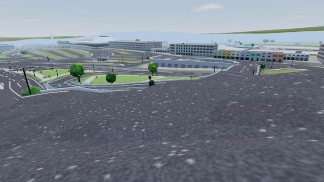 |
| 🆕 | -2477 | 45 | service (#4989) | zona nueva | en coche | El coche se queda atascado | 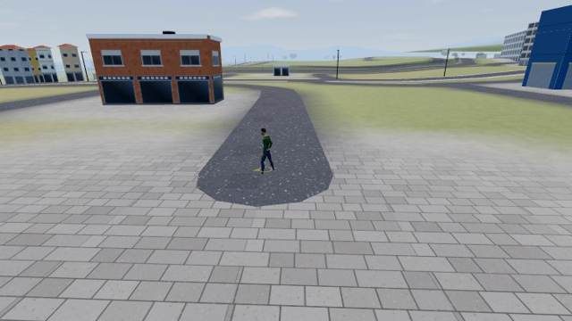 |
| ↻ | 674 | 3460 | path (#2562) | mapa entero | a pie | El personaje se queda atascado andando por el camino | 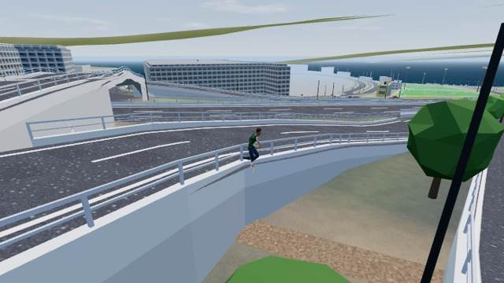 |
| ↻ | -3253 | -271 | Carretera General del Norte (#4834) | zona nueva | en coche | El coche se queda atascado | 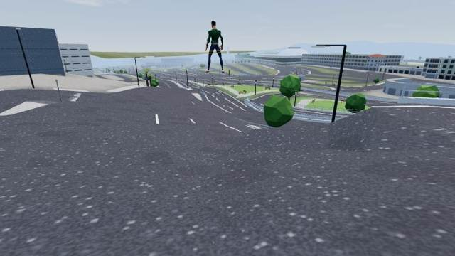 |
| ↻ | -86 | 232 | Calle Heraclio Sánchez (#0) | zona nueva | a pie | El personaje se queda atascado andando por el camino | 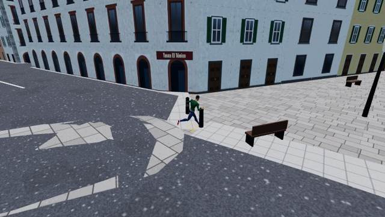 |
| ↻ | -279 | 583 | footway (#3879) | zona nueva | a pie | El personaje se queda atascado andando por el camino | 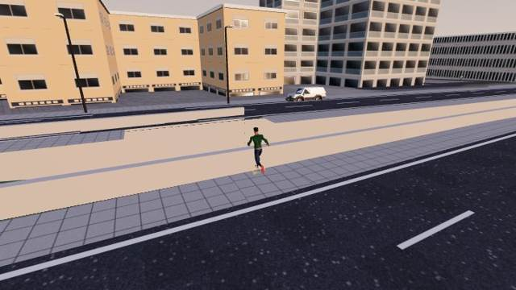 |
| ↻ | -3066 | 21 | footway (#5106) | zona nueva | a pie | El personaje se queda atascado andando por el camino |  |
| ↻ | -3052 | 39 | footway (#5112) | zona nueva | a pie | El personaje se queda atascado andando por el camino | 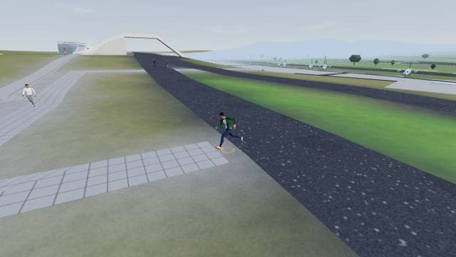 |
| ↻ | -3146 | 84 | footway (#5172) | zona nueva | a pie | El personaje se queda atascado andando por el camino | 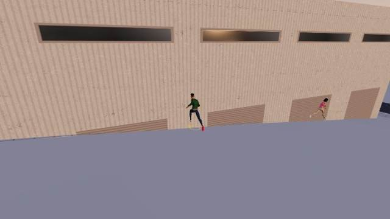 |
| ↻ | -3150 | 101 | footway (#5174) | zona nueva | a pie | El personaje se queda atascado andando por el camino | 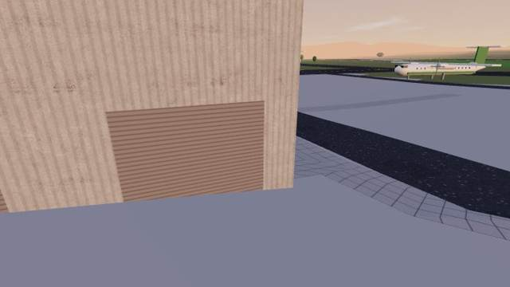 |
| ↻ | -3162 | -3 | footway (#5179) | zona nueva | a pie | El personaje se queda atascado andando por el camino | 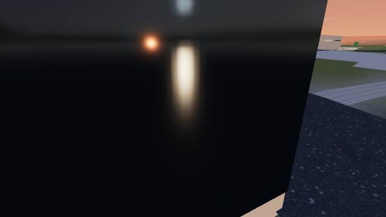 |

## Edificios sobre la vía (35)

| | X | Z | Vía | Pasada | Prueba | Detalle | Captura |
|---|---|---|---|---|---|---|---|
| 🆕 | 624 | -345 | Calle Pista Militar San Roque (#560) | mapa entero | en coche | Un edificio tapa la vía: la calle entra en él (dato de OSM o edificio mal puesto) |  |
| 🆕 | 1755 | 3764 | service (#1580) | mapa entero | en coche | Un edificio tapa la vía (Mercadona): la calle entra en él (dato de OSM o edificio mal puesto) | 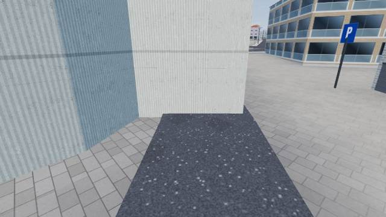 |
| 🆕 | -859 | 84 | service (#2011) | mapa entero | en coche | Un edificio tapa la vía: la calle entra en él (dato de OSM o edificio mal puesto) | 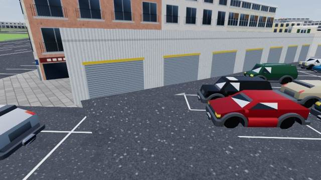 |
| 🆕 | 960 | 1588 | Calle Alfa (#3285) | mapa entero | en coche | Un edificio tapa la vía: la calle entra en él (dato de OSM o edificio mal puesto) | 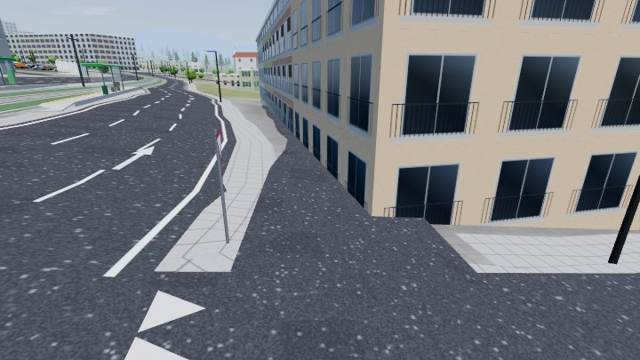 |
| 🆕 | -19 | 218 | Calle Barcelona (#3340) | mapa entero | en coche | Un edificio tapa la vía: la calle entra en él (dato de OSM o edificio mal puesto) | 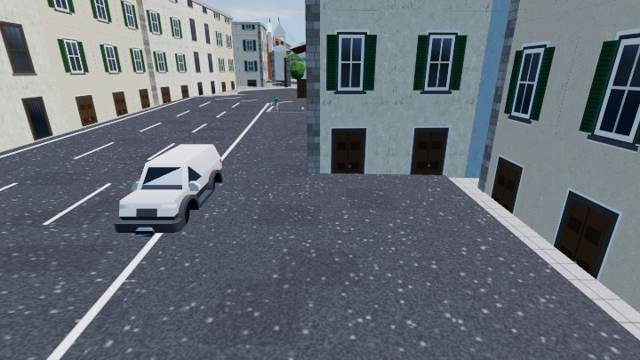 |
| 🆕 | 789 | 2973 | service (#3998) | mapa entero | en coche | Un edificio tapa la vía (IKEA): la calle entra en él (dato de OSM o edificio mal puesto) | 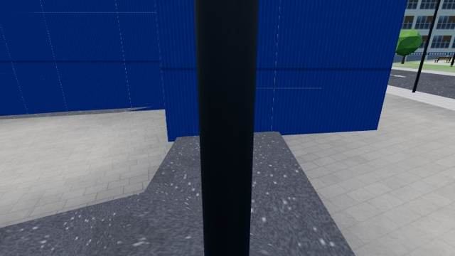 |
| 🆕 | -3646 | 947 | service (#5022) | mapa entero | en coche | Un edificio tapa la vía: la calle entra en él (dato de OSM o edificio mal puesto) |  |
| 🆕 | 665 | -578 | track (#641) | mapa entero | a pie | Un edificio tapa el camino | 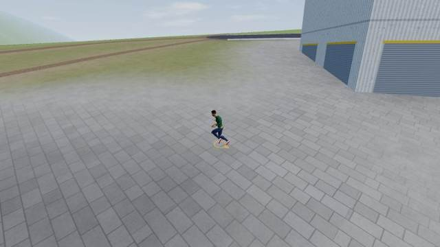 |
| 🆕 | 804 | 904 | footway (#1998) | mapa entero | a pie | Un edificio tapa el camino | 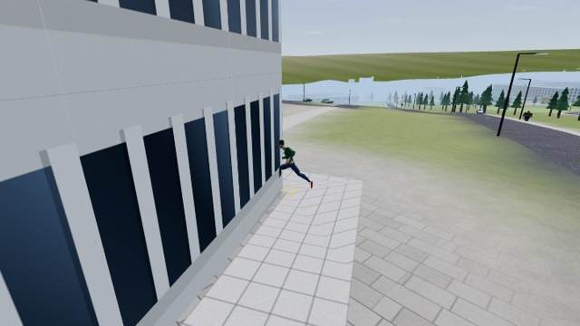 |
| 🆕 | 1015 | 1562 | Calle La Tierra (#2071) | mapa entero | a pie | Un edificio tapa el camino | 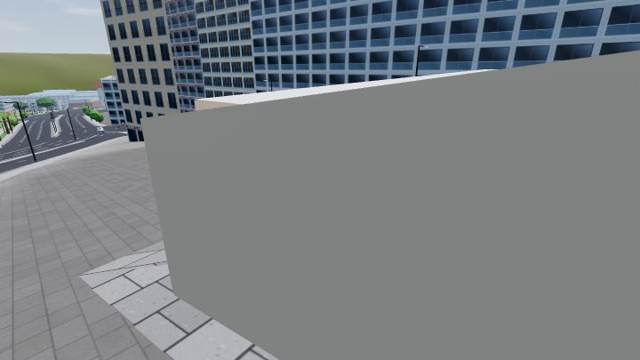 |
| 🆕 | -516 | 754 | path (#2729) | mapa entero | a pie | Un edificio tapa el camino |  |
| 🆕 | 1250 | 1996 | path (#2752) | mapa entero | a pie | Un edificio tapa el camino (Facultad de Ciencias de la Información) |  |
| 🆕 | -721 | 592 | footway (#2759) | mapa entero | a pie | Un edificio tapa el camino |  |
| 🆕 | 1905 | 1343 | footway (#3193) | mapa entero | a pie | Un edificio tapa el camino (Pabellón Islas Canarias) |  |
| 🆕 | -189 | -11 | steps (#3673) | mapa entero | a pie | Un edificio tapa el camino |  |
| 🆕 | -182 | -25 | Pasaje Aguere (#3674) | mapa entero | a pie | Un edificio tapa el camino |  |
| 🆕 | -185 | -12 | steps (#3675) | mapa entero | a pie | Un edificio tapa el camino |  |
| 🆕 | 570 | 1211 | footway (#4165) | mapa entero | a pie | Un edificio tapa el camino (Edificio Beneharo) |  |
| 🆕 | 246 | 1039 | footway (#4287) | mapa entero | a pie | Un edificio tapa el camino |  |
| 🆕 | 260 | 1016 | footway (#4290) | mapa entero | a pie | Un edificio tapa el camino |  |
| 🆕 | 246 | 1037 | footway (#4291) | mapa entero | a pie | Un edificio tapa el camino |  |
| 🆕 | 2354 | 3463 | footway (#4364) | mapa entero | a pie | Un edificio tapa el camino (Instituto de Tecnologías Biomédicas) |  |
| 🆕 | 38 | 294 | footway (#4429) | mapa entero | a pie | Un edificio tapa el camino |  |
| 🆕 | -3413 | -399 | track (#4770) | mapa entero | a pie | Un edificio tapa el camino |  |
| 🆕 | -3742 | 1138 | track (#4901) | mapa entero | a pie | Un edificio tapa el camino |  |
| 🆕 | 3398 | 2077 | footway (#5316) | mapa entero | a pie | Un edificio tapa el camino |  |
| 🆕 | 3398 | 2080 | steps (#5317) | mapa entero | a pie | Un edificio tapa el camino |  |
| 🆕 | 1493 | 4131 | Urbanización El Cardonal (#5542) | mapa entero | a pie | Un edificio tapa el camino |  |
| 🆕 | 1570 | 4056 | Urbanización El Cardonal (#5555) | mapa entero | a pie | Un edificio tapa el camino |  |
| 🆕 | -3126 | 25 | service (#4935) | zona nueva | en coche | Un edificio tapa la vía: la calle entra en él (dato de OSM o edificio mal puesto) |  |
| 🆕 | -3113 | 18 | service (#4936) | zona nueva | en coche | Un edificio tapa la vía: la calle entra en él (dato de OSM o edificio mal puesto) |  |
| ↻ | 542 | -907 | Camino La Rúa (#308) | mapa entero | en coche | Un edificio tapa la vía: la calle entra en él (dato de OSM o edificio mal puesto) |  |
| ↻ | -853 | 58 | service (#2569) | mapa entero | en coche | Un edificio tapa la vía: la calle entra en él (dato de OSM o edificio mal puesto) |  |
| ↻ | -3072 | -67 | service (#5037) | zona nueva | en coche | Un edificio tapa la vía: la calle entra en él (dato de OSM o edificio mal puesto) |  |
| ↻ | -3126 | 36 | footway (#4952) | zona nueva | a pie | Un edificio tapa el camino |  |

## Se sale de la calzada (24)

| | X | Z | Vía | Pasada | Prueba | Detalle | Captura |
|---|---|---|---|---|---|---|---|
| 🆕 | 1017 | 1836 | service (#118) | mapa entero | en coche | El coche se sale de la calzada (5.6 m del eje) |  |
| 🆕 | 661 | -368 | Calle Pista Militar San Roque (#560) | mapa entero | en coche | El coche se sale de la calzada (7.0 m del eje) |  |
| 🆕 | 297 | 75 | service (#573) | mapa entero | en coche | El coche se sale de la calzada (5.6 m del eje) |  |
| 🆕 | -214 | 1960 | Calle Fresón (#626) | mapa entero | en coche | El coche se sale de la calzada (7.1 m del eje) |  |
| 🆕 | 2357 | 1165 | residential (#1117) | mapa entero | en coche | El coche se sale de la calzada (7.2 m del eje) |  |
| 🆕 | -307 | 852 | Rambla Las Clavellinas (#1190) | mapa entero | en coche | El coche se sale de la calzada (7.2 m del eje) |  |
| 🆕 | -695 | 994 | service (#1192) | mapa entero | en coche | El coche se sale de la calzada (5.7 m del eje) |  |
| 🆕 | 2357 | 945 | service (#1312) | mapa entero | en coche | El coche se sale de la calzada (5.7 m del eje) |  |
| 🆕 | 1385 | 3221 | service (#1486) | mapa entero | en coche | El coche se sale de la calzada (6.0 m del eje) |  |
| 🆕 | 1278 | 1910 | service (#1714) | mapa entero | en coche | El coche se sale de la calzada (5.7 m del eje) |  |
| 🆕 | -102 | 664 | service (#2034) | mapa entero | en coche | El coche se sale de la calzada (5.8 m del eje) |  |
| 🆕 | -2237 | 492 | service (#2865) | mapa entero | en coche | El coche se sale de la calzada (5.7 m del eje) |  |
| 🆕 | -1264 | -217 | service (#3771) | mapa entero | en coche | El coche se sale de la calzada (5.8 m del eje) |  |
| 🆕 | 2389 | 1927 | service (#4592) | mapa entero | en coche | El coche se sale de la calzada (5.7 m del eje) |  |
| 🆕 | -4257 | -67 | service (#4734) | mapa entero | en coche | El coche se sale de la calzada (5.9 m del eje) |  |
| 🆕 | -3607 | 931 | service (#5022) | mapa entero | en coche | El coche se sale de la calzada (5.7 m del eje) |  |
| 🆕 | -3682 | 891 | service (#5025) | mapa entero | en coche | El coche se sale de la calzada (5.9 m del eje) |  |
| 🆕 | 3450 | 1849 | Calle Antequera y Bobadilla (#5196) | mapa entero | en coche | El coche se sale de la calzada (7.0 m del eje) |  |
| 🆕 | -2601 | 67 | service (#4977) | zona nueva | en coche | El coche se sale de la calzada (5.9 m del eje) |  |
| ↻ | 314 | 289 | Calle Ladera de San Roque (#845) | mapa entero | en coche | El coche se sale de la calzada (5.6 m del eje) |  |
| ↻ | 363 | -1250 | Camino Madre del Agua (#2226) | mapa entero | en coche | El coche se sale de la calzada (5.6 m del eje) |  |
| ↻ | -2604 | 97 | service (#4980) | zona nueva | en coche | El coche se sale de la calzada (5.7 m del eje) |  |
| ↻ | -2503 | 16 | service (#4982) | zona nueva | en coche | El coche se sale de la calzada (5.6 m del eje) |  |
| ↻ | -2983 | -241 | service (#4998) | zona nueva | en coche | El coche se sale de la calzada (5.6 m del eje) |  |

## Se hunde (15)

| | X | Z | Vía | Pasada | Prueba | Detalle | Captura |
|---|---|---|---|---|---|---|---|
| 🆕 | 1775 | 3118 | tertiary (#2260) | mapa entero | en coche | El coche va 1.0 m por debajo de la calzada |  |
| 🆕 | 2210 | 3312 | service (#3098) | mapa entero | en coche | El coche va 1.2 m por debajo de la calzada |  |
| 🆕 | 248 | -554 | service (#3590) | mapa entero | en coche | El coche va 0.8 m por debajo de la calzada |  |
| 🆕 | 137 | -628 | service (#3676) | mapa entero | en coche | El coche va 2.5 m por debajo de la calzada |  |
| 🆕 | -298 | -261 | Calle Alcalde Alonso Suárez Melián (#568) | mapa entero | a pie | El personaje se hunde 0.36 m bajo la superficie visible (suelo) |  |
| 🆕 | 243 | -352 | cycleway (#838) | mapa entero | a pie | El personaje se hunde 0.58 m bajo la superficie visible (suelo) |  |
| 🆕 | 1145 | 2285 | footway (#887) | mapa entero | a pie | El personaje se hunde 0.33 m bajo la superficie visible (suelo) |  |
| 🆕 | 1759 | 2195 | path (#2621) | mapa entero | a pie | El personaje se hunde 0.61 m bajo la superficie visible (suelo) |  |
| 🆕 | 551 | 75 | footway (#2923) | mapa entero | a pie | El personaje se hunde 0.38 m bajo la superficie visible (suelo) |  |
| 🆕 | 172 | 740 | footway (#4222) | mapa entero | a pie | El personaje se hunde 1.00 m bajo la superficie visible (suelo) |  |
| 🆕 | -2943 | -89 | service (#4774) | zona nueva | en coche | El coche va 2.5 m por debajo de la calzada |  |
| ↻ | 720 | 3389 | motorway_link (#826) | mapa entero | en coche | El coche va 1.9 m por debajo de la calzada |  |
| ↻ | -3040 | 29 | footway (#5106) | zona nueva | a pie | El personaje se hunde 0.27 m bajo la superficie visible (suelo) |  |
| ↻ | -3087 | 16 | footway (#5116) | zona nueva | a pie | El personaje se hunde 0.83 m bajo la superficie visible (suelo) |  |
| ↻ | -3068 | 17 | footway (#5120) | zona nueva | a pie | El personaje se hunde 0.26 m bajo la superficie visible (suelo) |  |

## Vuela sobre la calzada (9)

| | X | Z | Vía | Pasada | Prueba | Detalle | Captura |
|---|---|---|---|---|---|---|---|
| 🆕 | 941 | 2868 | tertiary (#467) | mapa entero | en coche | El coche va 1.1 m por encima de la calzada |  |
| 🆕 | 1857 | 3201 | motorway_link (#2467) | mapa entero | en coche | El coche va 1.2 m por encima de la calzada |  |
| 🆕 | 1857 | 3202 | service (#2966) | mapa entero | en coche | El coche va 1.1 m por encima de la calzada |  |
| 🆕 | -3264 | -248 | motorway_link (#4884) | zona nueva | en coche | El coche va 1.1 m por encima de la calzada |  |
| ↻ | 516 | -332 | Camino Las Estaciones (#637) | mapa entero | en coche | El coche va 1.0 m por encima de la calzada |  |
| ↻ | -3253 | -271 | Carretera General del Norte (#4834) | zona nueva | en coche | El coche va 1.0 m por encima de la calzada |  |
| ↻ | -3269 | -270 | secondary_link (#4835) | zona nueva | en coche | El coche va 1.2 m por encima de la calzada |  |
| ↻ | -3275 | -267 | secondary_link (#4866) | zona nueva | en coche | El coche va 2.9 m por encima de la calzada |  |
| ↻ | -3247 | -360 | service (#5068) | zona nueva | en coche | El coche va 1.6 m por encima de la calzada |  |

## Texturas cruzadas (suelo sobre la carretera) (6)

| | X | Z | Vía | Pasada | Prueba | Detalle | Captura |
|---|---|---|---|---|---|---|---|
| 🆕 | 604 | 406 | service (#810) | mapa entero | superficies | Superficie «aL_t4_172» 0.05 m por encima del asfalto |  |
| 🆕 | 314 | -33 | primary_link (#823) | mapa entero | superficies | Superficie «aL_t4_130» 0.15 m por encima del asfalto |  |
| 🆕 | 343 | 258 | primary_link (#842) | mapa entero | superficies | Superficie «aL_t4_130» 0.08 m por encima del asfalto |  |
| 🆕 | 312 | -36 | Vía de Ronda de La Laguna (#1983) | mapa entero | superficies | Superficie «aL_t4_130» 0.11 m por encima del asfalto |  |
| 🆕 | 473 | 280 | Vía de Ronda de La Laguna (#2021) | mapa entero | superficies | Superficie «aL_t4_172» 0.13 m por encima del asfalto |  |
| 🆕 | 428 | 278 | Vía de Ronda de La Laguna (#3604) | mapa entero | superficies | Superficie «aL_t4_172» 0.10 m por encima del asfalto |  |

## Saltos de altura (5)

| | X | Z | Vía | Pasada | Prueba | Detalle | Captura |
|---|---|---|---|---|---|---|---|
| 🆕 | 2210 | 3312 | service (#3098) | mapa entero | en coche | Salto brusco de altura (-1.3 m en un fotograma) |  |
| 🆕 | 137 | -628 | service (#3676) | mapa entero | en coche | Salto brusco de altura (-2.6 m en un fotograma) |  |
| 🆕 | -2943 | -89 | service (#4774) | zona nueva | en coche | Salto brusco de altura (-2.6 m en un fotograma) |  |
| ↻ | 720 | 3389 | motorway_link (#826) | mapa entero | en coche | Salto brusco de altura (-1.8 m en un fotograma) |  |
| ↻ | -3247 | -360 | service (#5068) | zona nueva | en coche | Salto brusco de altura (1.7 m en un fotograma) |  |

## Objetos flotando sobre la calzada (2)

| | X | Z | Vía | Pasada | Prueba | Detalle | Captura |
|---|---|---|---|---|---|---|---|
| 🆕 | 342 | 477 | unclassified (#1922) | mapa entero | superficies | Algo plano («footway») flota 0.8 m sobre la calzada |  |
| ↻ | 516 | -332 | Camino Las Estaciones (#637) | mapa entero | superficies | Algo plano («asphalt») flota 1.0 m sobre la calzada |  |

## No termina el recorrido (1)

| | X | Z | Vía | Pasada | Prueba | Detalle | Captura |
|---|---|---|---|---|---|---|---|
| ↻ | 481 | -308 | Calle Pista Militar San Roque (#557) | mapa entero | en coche | No termina la vía en 38 s (90 m sin recorrer) |  |
