# Revisión de jugabilidad — v0.69.0 (2026-10-13 0136)

Agente revisor automático. Estado: **terminado**. Tiempo: 367 s.

- Zonas nuevas de esta versión: Rotondas Trinidad / Vía de Ronda, Rampas solapadas Geneto, Garaje TF-5.
- Plan: surf 1008, walk 357, drive 1008.
- Comparado con: revision_v0.48.0_2026-10-06_2008.json.

**47 avisos: 47 nuevos, 0 siguen; 39 arreglados desde el informe anterior.**

## Arreglados

| X | Z | Vía | Tipo |
|---|---|---|---|
| 752 | 1268 | primary_link (#19) | Objetos flotando sobre la calzada |
| 753 | 3484 | motorway_link (#399) | Objetos flotando sobre la calzada |
| 885 | 3177 | tertiary_link (#400) | Objetos flotando sobre la calzada |
| 742 | 838 | primary_link (#668) | Objetos flotando sobre la calzada |
| 464 | 1421 | primary_link (#813) | Objetos flotando sobre la calzada |
| 1512 | 1744 | Avenida de los Menceyes (#1052) | Objetos flotando sobre la calzada |
| 2216 | 3537 | motorway_link (#2333) | Texturas cruzadas (suelo sobre la carretera) |
| -731 | 335 | Camino San Francisco (#2831) | Objetos flotando sobre la calzada |
| -2273 | -283 | Carretera General del Norte (#4728) | Texturas cruzadas (suelo sobre la carretera) |
| 344 | 1506 | Autopista del Norte (#1281) | Texturas cruzadas (suelo sobre la carretera) |
| 348 | 1511 | Autopista del Norte (#1281) | Objetos flotando sobre la calzada |
| 2150 | 3200 | unclassified (#364) | Atascos |
| 780 | 3438 | tertiary (#398) | Vuela sobre la calzada |
| 750 | 3486 | motorway_link (#399) | Vuela sobre la calzada |
| 375 | 1456 | Vía de Ronda de La Laguna (#446) | Atascos |
| 742 | 840 | primary_link (#668) | Vuela sobre la calzada |
| 741 | 837 | primary_link (#668) | Atascos |
| 2226 | 3568 | motorway_link (#718) | Vuela sobre la calzada |
| 389 | 1487 | Vía de Ronda de La Laguna (#724) | Se hunde |
| 392 | 1475 | Vía de Ronda de La Laguna (#724) | Atascos |
| 1174 | 2433 | motorway_link (#728) | Vuela sobre la calzada |
| 1837 | 3084 | tertiary (#913) | Se hunde |
| 1823 | 3077 | tertiary (#913) | Atascos |
| 801 | 3484 | Avenida Ghandi (#1229) | Vuela sobre la calzada |
| 2199 | 3565 | Autopista del Norte (#1306) | Vuela sobre la calzada |
| 328 | 18 | Vía de Ronda de La Laguna (#1975) | Vuela sobre la calzada |
| 2226 | 3568 | Autopista del Norte (#2320) | Vuela sobre la calzada |
| 2219 | 3542 | motorway_link (#2333) | Vuela sobre la calzada |
| 742 | 842 | unclassified (#2410) | Vuela sobre la calzada |
| 686 | 3385 | tertiary (#2421) | Vuela sobre la calzada |
| 780 | 3440 | tertiary (#2428) | Vuela sobre la calzada |
| -2274 | -282 | Carretera General del Norte (#4728) | Vuela sobre la calzada |
| -307 | 852 | Rambla Las Clavellinas (#1186) | Se sale de la calzada |
| 319 | 1479 | Autopista del Norte (#1281) | Atascos |
| 2400 | 1136 | residential (#1307) | Se sale de la calzada |
| 2400 | 1143 | residential (#1307) | Atascos |
| 2358 | 944 | service (#1308) | Se sale de la calzada |
| 2400 | 1582 | Calle Embudo (#1309) | Atascos |
| 2400 | 1694 | Calle la Calma (#1374) | Atascos |

## Se hunde (10)

| | X | Z | Vía | Pasada | Prueba | Detalle | Captura |
|---|---|---|---|---|---|---|---|
| 🆕 | 151 | 159 | footway (#572) | rotación | a pie | El personaje se hunde 0.35 m bajo la superficie visible (suelo) | 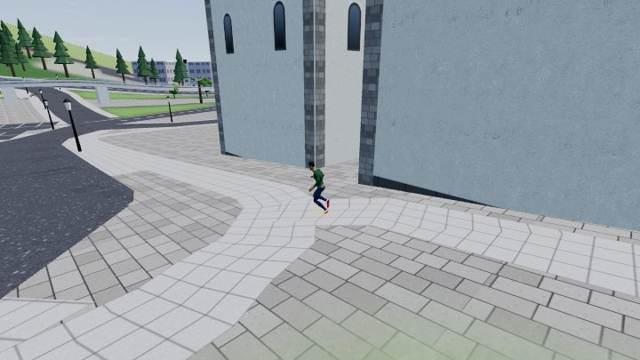 |
| 🆕 | 1151 | 2299 | footway (#887) | rotación | a pie | El personaje se hunde 0.44 m bajo la superficie visible (suelo) | 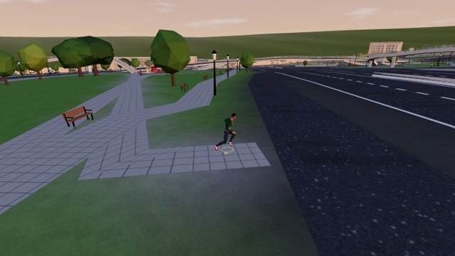 |
| 🆕 | 1896 | 1788 | footway (#1428) | rotación | a pie | El personaje se hunde 0.56 m bajo la superficie visible (suelo) | 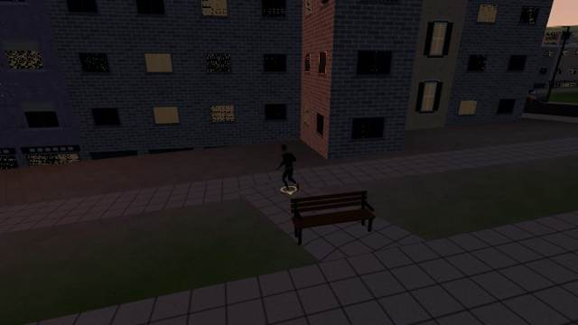 |
| 🆕 | 2210 | 3312 | service (#3098) | zona nueva | en coche | El coche va 1.7 m por debajo de la calzada | 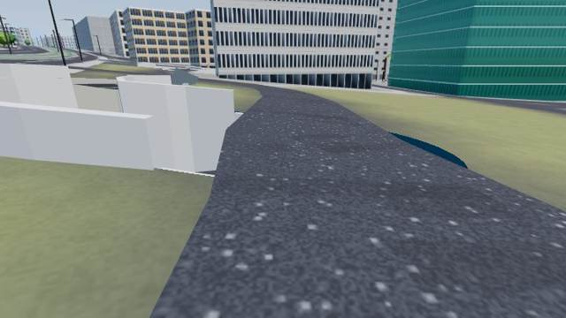 |
| 🆕 | -37 | 1152 | footway (#3578) | zona nueva | a pie | El personaje se hunde 0.26 m bajo la superficie visible (suelo) | 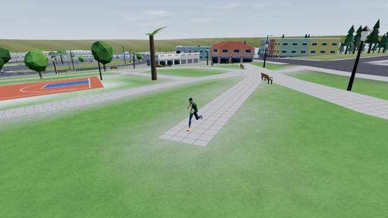 |
| 🆕 | -166 | 729 | footway (#3893) | zona nueva | a pie | El personaje se hunde 0.60 m bajo la superficie visible (suelo) | 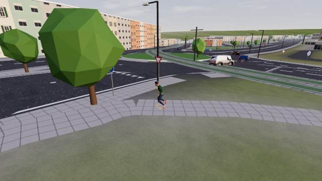 |
| 🆕 | 728 | 930 | footway (#4153) | zona nueva | a pie | El personaje se hunde 1.04 m bajo la superficie visible (trim) | 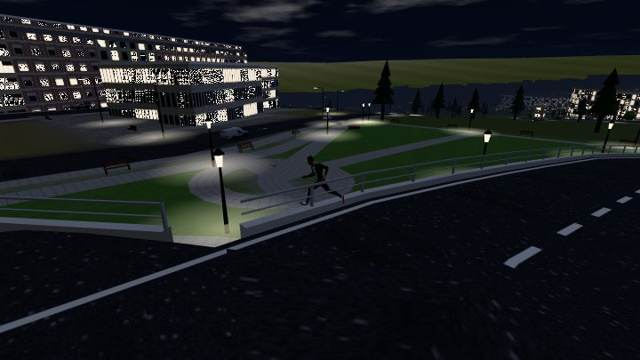 |
| 🆕 | 168 | 717 | footway (#4222) | zona nueva | a pie | El personaje se hunde 1.09 m bajo la superficie visible (suelo) | 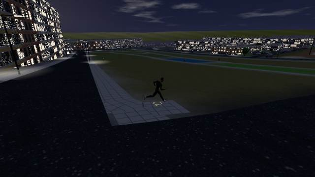 |
| 🆕 | 225 | 999 | footway (#4283) | zona nueva | a pie | El personaje se hunde 0.60 m bajo la superficie visible (suelo) | 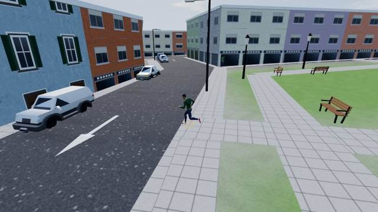 |
| 🆕 | 240 | 1029 | footway (#4291) | zona nueva | a pie | El personaje se hunde 0.49 m bajo la superficie visible (suelo) |  |

## Edificios sobre la vía (10)

| | X | Z | Vía | Pasada | Prueba | Detalle | Captura |
|---|---|---|---|---|---|---|---|
| 🆕 | 543 | -908 | Camino La Rúa (#308) | riesgo | en coche | Un edificio tapa la vía: la calle entra en él (dato de OSM o edificio mal puesto) | 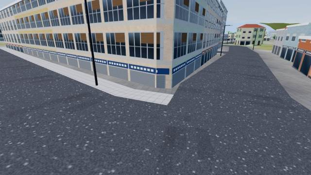 |
| 🆕 | 665 | -578 | track (#641) | rotación | a pie | Un edificio tapa el camino | 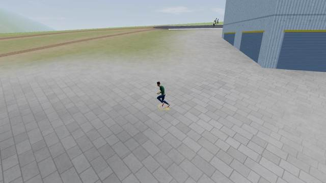 |
| 🆕 | -176 | -66 | Pasaje Teide (#753) | rotación | a pie | Un edificio tapa el camino | 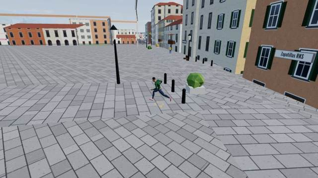 |
| 🆕 | -212 | 54 | Pasaje Aguere (#754) | rotación | a pie | Un edificio tapa el camino | 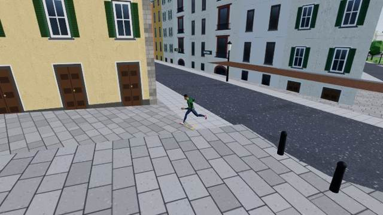 |
| 🆕 | 570 | 1211 | footway (#4165) | zona nueva | a pie | Un edificio tapa el camino (Edificio Beneharo) | 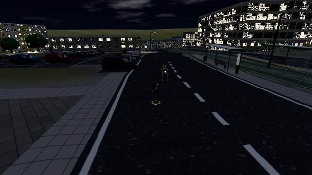 |
| 🆕 | 401 | 1011 | footway (#4172) | zona nueva | a pie | Un edificio tapa el camino | 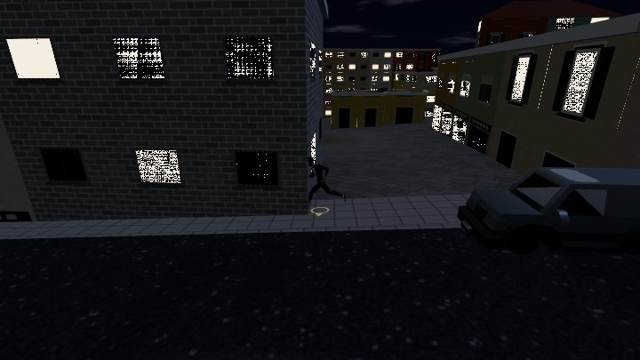 |
| 🆕 | 301 | 903 | footway (#4177) | zona nueva | a pie | Un edificio tapa el camino | 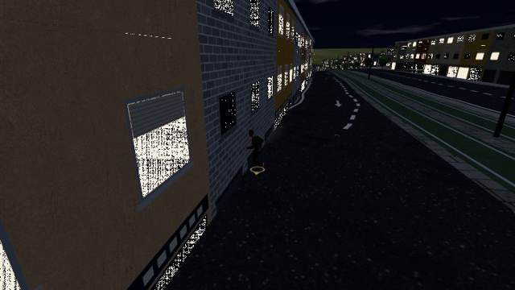 |
| 🆕 | 326 | 995 | footway (#4190) | zona nueva | a pie | Un edificio tapa el camino | 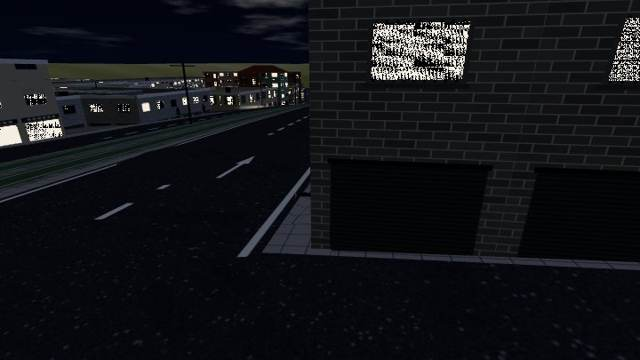 |
| 🆕 | 233 | 1060 | footway (#4287) | zona nueva | a pie | Un edificio tapa el camino | 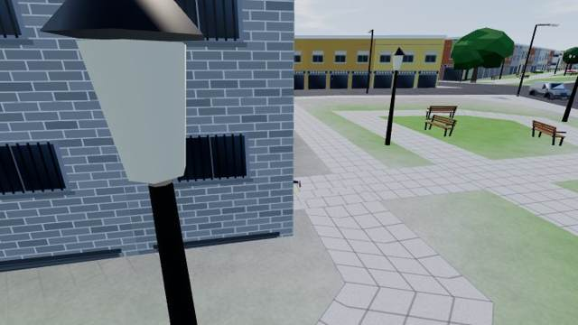 |
| 🆕 | 245 | 1037 | footway (#4291) | zona nueva | a pie | Un edificio tapa el camino | 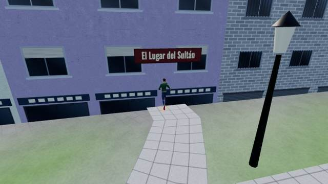 |

## Atascos (8)

| | X | Z | Vía | Pasada | Prueba | Detalle | Captura |
|---|---|---|---|---|---|---|---|
| 🆕 | 820 | 3494 | Travesía Enlace Andenes Sobradillo (#1232) | riesgo | en coche | El coche se queda atascado | 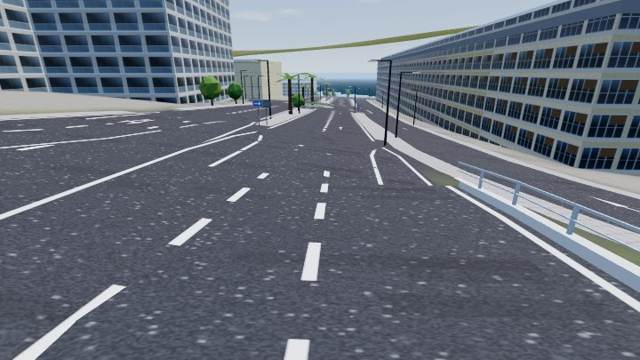 |
| 🆕 | 377 | -268 | Vía de Ronda de La Laguna (#2576) | riesgo | en coche | El coche se queda atascado | 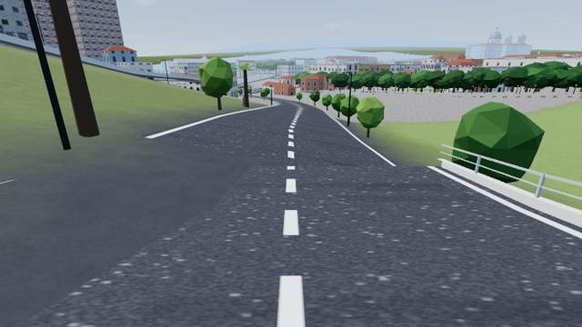 |
| 🆕 | -251 | 2619 | Calle Amazonas (#864) | rotación | a pie | El personaje se queda atascado andando por el camino | 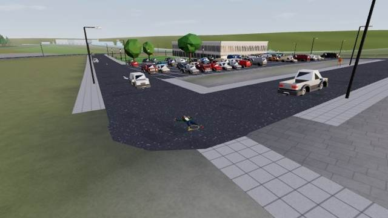 |
| 🆕 | 2236 | 3468 | service (#352) | zona nueva | en coche | El coche se queda atascado contra un obstáculo/muro | 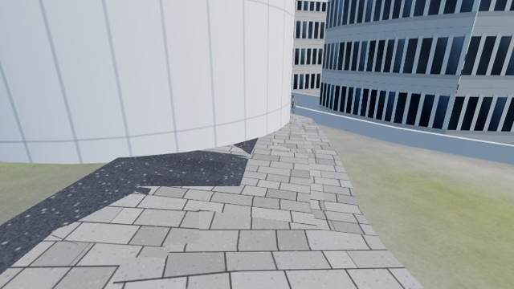 |
| 🆕 | 2210 | 3310 | service (#3098) | zona nueva | en coche | El coche se queda atascado |  |
| 🆕 | 746 | 865 | footway (#4153) | zona nueva | a pie | El personaje se queda atascado andando por el camino |  |
| 🆕 | -316 | 818 | path (#4678) | zona nueva | a pie | El personaje se queda atascado andando por el camino | 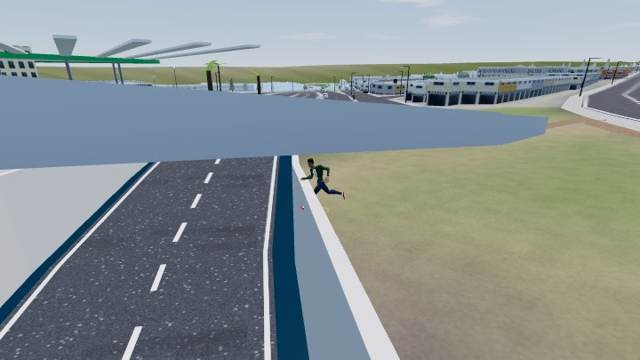 |
| 🆕 | -307 | 809 | path (#4680) | zona nueva | a pie | El personaje se queda atascado andando por el camino | 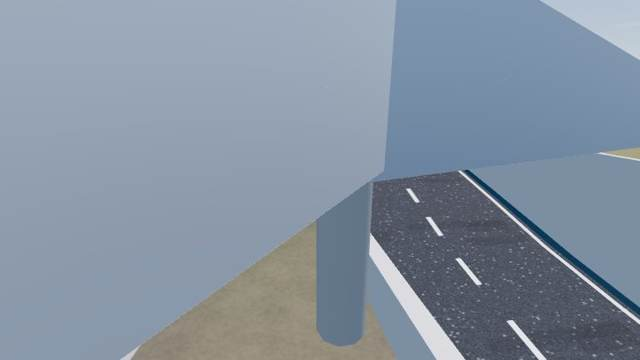 |

## Se sale de la calzada (6)

| | X | Z | Vía | Pasada | Prueba | Detalle | Captura |
|---|---|---|---|---|---|---|---|
| 🆕 | 315 | 290 | Calle Ladera de San Roque (#845) | riesgo | en coche | El coche se sale de la calzada (5.8 m del eje) | 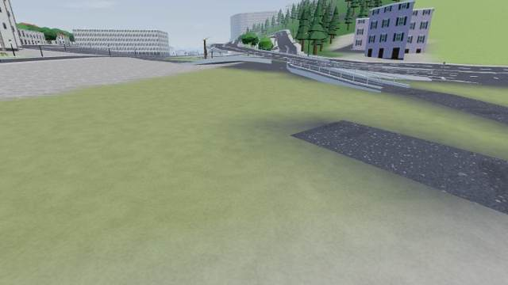 |
| 🆕 | 297 | 74 | service (#573) | rotación | en coche | El coche se sale de la calzada (5.7 m del eje) | 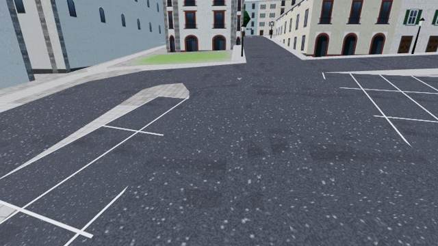 |
| 🆕 | 2357 | 945 | service (#1312) | rotación | en coche | El coche se sale de la calzada (5.7 m del eje) | 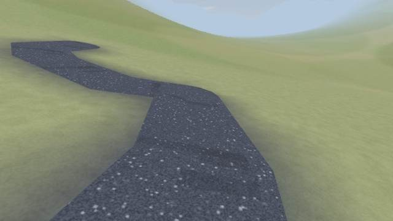 |
| 🆕 | 1386 | 3221 | service (#1486) | rotación | en coche | El coche se sale de la calzada (5.7 m del eje) | 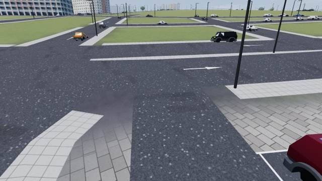 |
| 🆕 | -307 | 853 | Rambla Las Clavellinas (#1190) | zona nueva | en coche | El coche se sale de la calzada (7.0 m del eje) | 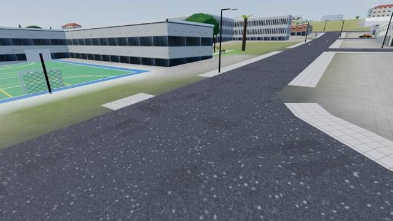 |
| 🆕 | -102 | 664 | service (#2034) | zona nueva | en coche | El coche se sale de la calzada (5.7 m del eje) | 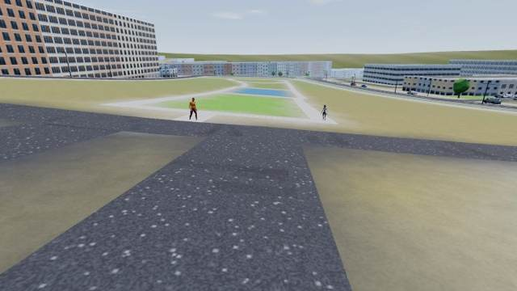 |

## Objetos flotando sobre la calzada (3)

| | X | Z | Vía | Pasada | Prueba | Detalle | Captura |
|---|---|---|---|---|---|---|---|
| 🆕 | 519 | -337 | Camino Las Estaciones (#637) | riesgo | superficies | Algo plano («asphalt») flota 0.8 m sobre la calzada | 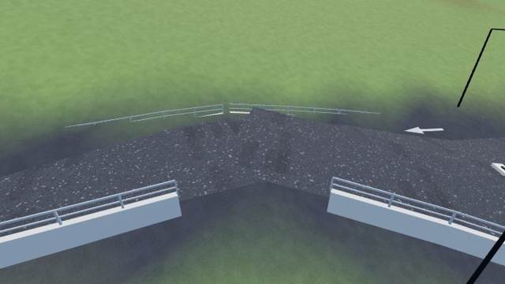 |
| 🆕 | 2097 | 3544 | Calle San Camilo (#1674) | riesgo | superficies | Algo plano («asphaltLines») flota 0.7 m sobre la calzada | 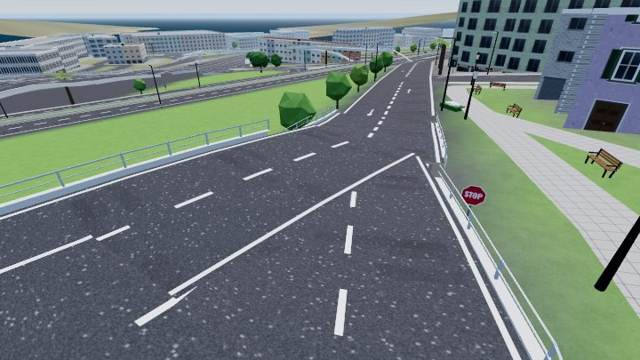 |
| 🆕 | -3255 | -251 | motorway_link (#4884) | riesgo | superficies | Algo plano («asphaltLines») flota 0.9 m sobre la calzada | 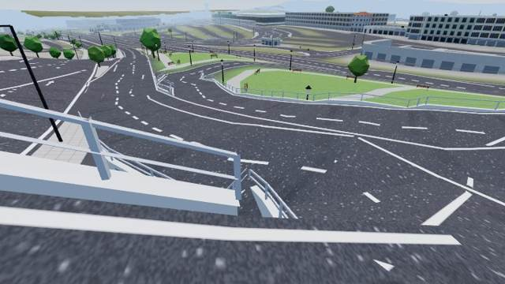 |

## Texturas cruzadas (suelo sobre la carretera) (3)

| | X | Z | Vía | Pasada | Prueba | Detalle | Captura |
|---|---|---|---|---|---|---|---|
| 🆕 | 2099 | 3549 | motorway_link (#719) | riesgo | superficies | Superficie «trim» 0.18 m por encima del asfalto | 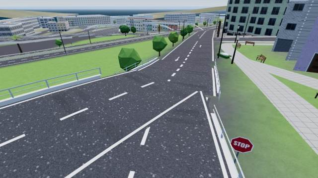 |
| 🆕 | 2099 | 3549 | Calle San Camilo (#1674) | riesgo | superficies | Superficie «trim» 0.18 m por encima del asfalto |  |
| 🆕 | -3268 | -269 | secondary_link (#4835) | riesgo | superficies | Superficie «trim» 0.57 m por encima del asfalto | 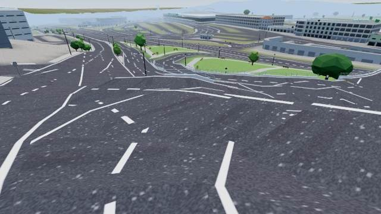 |

## Saltos de altura (3)

| | X | Z | Vía | Pasada | Prueba | Detalle | Captura |
|---|---|---|---|---|---|---|---|
| 🆕 | -495 | 683 | service (#2704) | riesgo | en coche | Salto brusco de altura (-1.2 m en un fotograma) |  |
| 🆕 | -3274 | -264 | secondary_link (#4866) | riesgo | en coche | Salto brusco de altura (-1.5 m en un fotograma) |  |
| 🆕 | 2210 | 3312 | service (#3098) | zona nueva | en coche | Salto brusco de altura (-1.9 m en un fotograma) |  |

## Vuela sobre la calzada (3)

| | X | Z | Vía | Pasada | Prueba | Detalle | Captura |
|---|---|---|---|---|---|---|---|
| 🆕 | -495 | 683 | service (#2704) | riesgo | en coche | El coche va 1.3 m por encima de la calzada | 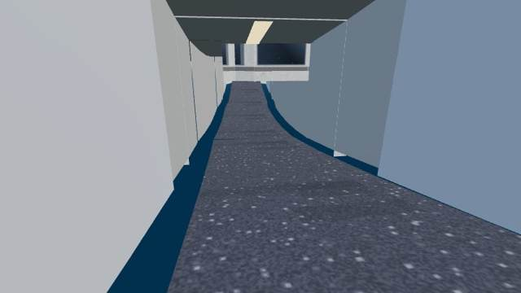 |
| 🆕 | -3269 | -270 | secondary_link (#4835) | riesgo | en coche | El coche va 1.4 m por encima de la calzada | 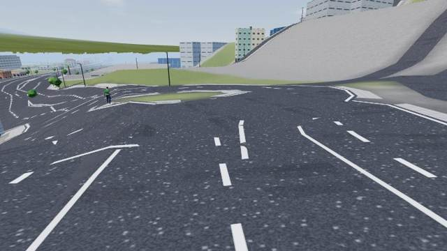 |
| 🆕 | -3274 | -265 | secondary_link (#4866) | riesgo | en coche | El coche va 1.3 m por encima de la calzada | 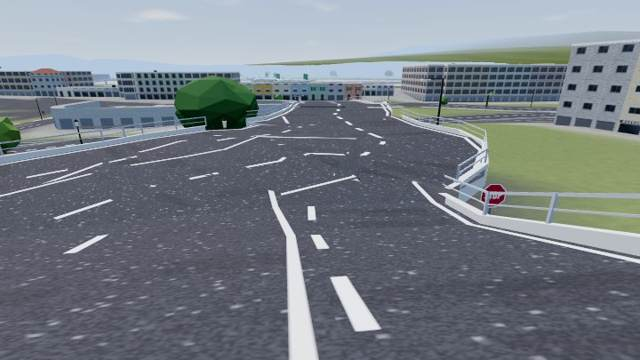 |

## No termina el recorrido (1)

| | X | Z | Vía | Pasada | Prueba | Detalle | Captura |
|---|---|---|---|---|---|---|---|
| 🆕 | 480 | -307 | Calle Pista Militar San Roque (#557) | riesgo | en coche | No termina la vía en 38 s (90 m sin recorrer) | 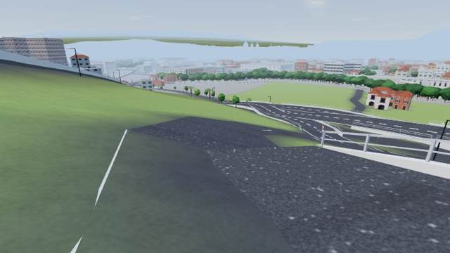 |
